# Data model and schema architecture

> **Status: Phase 10 design proposal, 2026-10-11. Nothing here is implemented.**
> No database exists, no migration has been written or applied, no dependency has been added, no
> resource has been provisioned, and no credential has been created. This document specifies the
> schema that a later, separately authorized phase will build.
>
> **How to read the markers.** Sections marked **Approved** restate owner decisions recorded in
> `docs/platform-architecture.md` section 11 and the ADRs; they are binding and must not be changed
> without a new owner decision. Sections marked **Proposed** are engineering recommendations awaiting
> approval. Sections marked **Unresolved** are questions this design deliberately did not answer.
>
> Nothing in this document establishes that the platform is secure or production-ready.

Related: `docs/platform-architecture.md` (boundaries, decision register) ·
`docs/payment-workflow.md` (D9 and D11 policy) · `docs/security.md` (authorization matrix and threat
model) · `docs/admin-dashboard.md` (operational surfaces) · `docs/migration-plan.md` (import rules) ·
`docs/decisions/0005-neon-postgresql-and-vercel-hosting.md` and
`docs/decisions/0006-neon-object-storage.md`.

---

## 1. Existing-system baseline

Recorded before any design, so that the design is not built on an assumption about what exists.

### 1.1 What the repository actually contains

| Area | Verified fact |
| --- | --- |
| Framework | Next.js 16.4.0 App Router, React 19.3.0, strict TypeScript 5.9.3 (`package.json`) |
| Routes | 8 route files: `/`, `/products`, `/products/[slug]`, `/categories/[slug]`, `/cart`, `/checkout`, plus `not-found` and `error` |
| Client/server split | 19 files carry `'use client'`. Every page is a thin server shell that awaits `params`/`searchParams` and hands plain props to a client view |
| Data | `src/data/*.ts` fixture modules (22 products, 5 categories, 13 brands, 1 announcement, curation lists). No network call at runtime |
| Persistence | Browser `localStorage` only: `queenbees.cart.v1`, `queenbees.locale.v1`. Defensive parse, id validation against the catalog, quantity clamping |
| Global state | Exactly two external stores (`cart-store.ts`, `locale-store.ts`) consumed with `useSyncExternalStore`; both expose a frozen server snapshot |
| Money | Integer poisha throughout (`Money = number`, `POISHA_PER_BDT = 100`); division happens only at format time; discounts derived, never stored |
| Images | Local files under `public/catalog`; paths derived from a key in `src/lib/images.ts`; raw ``; `next/image` never used |
| Checks | `npm run lint`, `typecheck`, `check:catalog`, `check:i18n`, `build`, `verify:browser` (headless Chromium over CDP against a served build) |
| Git | Last commit `d765cd4` (Phase 5). Phase 6-9 work is uncommitted, and must stay uncommitted |

### 1.2 What does not exist

Verified by direct search, not assumed:

- **No database, ORM, migration, seed or query layer of any kind.**
- **No `route.ts` and no `middleware.ts`** - the application has no server endpoints at all.
- **No authentication, session, cookie, account, password or recovery code.**
- **No `process.env` reference and no `NEXT_PUBLIC_*` variable** anywhere in `src/`, `scripts/` or `next.config.ts`.
- **No `fetch(` call** in application code; the only network-shaped construct is the search form's `method="get"` navigation.
- **No upload path, no storage client, no presigned URL logic.**
- `/checkout` is **inert by design** and asserted so by the browser suite: zero forms, zero inputs, zero submit buttons, no external hosts.

The storefront is therefore a complete, honest, client-ready **demo**, and the backend is entirely
unbuilt. Any design statement about "the current system" that implies otherwise would be false.

### 1.3 Code-versus-documentation discrepancies

| # | Discrepancy | Evidence | Consequence for this design |
| --- | --- | --- | --- |
| B1 | `docs/architecture.md` states views depend on typed accessors so a backend adapter can replace `src/data/catalog.ts` untouched. In reality client views import the raw `products` array and filter/sort in the browser (`CatalogView.tsx`, `HomeSections.tsx`, `CartProvider.tsx`). | `src/features/catalog/query.ts` | The documented seam is thinner than described. A server-side catalog must also own query semantics, so the accessor contract must be redefined in Phase 11, not assumed. |
| B2 | `docs/security.md` states "No env files exist". A `.env` file **is** present in the working tree, untracked and gitignored, containing a plaintext third-party merchant account credential. | `.env` (89 bytes), `.gitignore` lines 10-11 | A live secret sits in the working tree of a repository whose strategic direction no longer uses that vendor. **Reported, not acted on**: removing or rotating it is the owner's decision. Corrected in `docs/security.md`; the value is not reproduced anywhere. |
| B3 | `next.config.ts` declares `images.formats` while `next/image` is never used and no `remotePatterns` exist. | `next.config.ts` | Image delivery must be designed from scratch against the D3 storage decision; the current config proves nothing. |
| B4 | `parseCatalogQuery` validates `category` and `sort` but not `brand`. | `src/features/catalog/query.ts` | A server-side query layer must validate every filter parameter against the database, deny-by-default. |
| B5 | Route `metadata` titles are hardcoded Bangla strings outside `dictionaries.ts`, so `check:i18n` cannot see them. | 5 route files | A user-facing string inventory is incomplete; Phase 11 must move them into the dictionary. |
| B6 | `getProductBySourceId`, `isKnownProduct` and `isTranslationKey` have no callers; the `availability: 'unknown'` branch and the placeholder-SVG path are unreachable. | source scan | Dead code is not evidence of a feature. Do not design against it. |

### 1.4 Contradictions inside the documentation

Found while cross-checking the sources this design depends on. Each is corrected in the owning
document by this phase, and each correction is a wording fix: **no approved policy changes.**

| # | Contradiction | Resolution |
| --- | --- | --- |
| D1 | `payment-workflow.md` section 7 says "Two actions only: verify and reject", while `admin-dashboard.md` says "Three actions - verify, reject, and mark falsely claimed". | Three actions. The two-action text predates D9's fake-order rule. |
| D2 | `platform-architecture.md` section 6 lists `refunded` inside the payment status enum; `payment-workflow.md` section 3 says refund state is not part of that enum. | Refund state is separate. `refunded` is removed from the payment enum. |
| D3 | D11 invariant 8 says "No expiry jobs or automatic stock-release logic are implemented in Phase 9", while 13.9.1 says expiry is automatic and system-driven. | Both are true of different things: invariant 8 is a **phase-scope** statement (nothing was built in Phase 9). Restated as scope, not policy. |
| D4 | Threat T9 says a delayed claim is "rejected or expired"; 13.9.2 says a submitted claim never expires. | T9 corrected: a submitted claim is resolved explicitly, never auto-expired. |
| D5 | `admin-dashboard.md` says a pre-dispatch refund returns stock to sellable; 13.10.10 says stock is restored only after physical receipt and inspection. | Both hold: 13.10.10 governs **goods**, which must be in hand; a pre-dispatch cancellation releases an untouched **reservation**. Clarified in both places. |
| D6 | `platform-architecture.md` says the catalog fits "well under the free tier's 10 GB"; the verified table and the D3 register row say **5 GB per project**. | 5 GB. |
| D7 | The register row for D9 cites sections 13.1-13.8, but the approved 24-hour expiry lives in 13.9. | Citation corrected to 13.1-13.9. |
| D8 | Section 2's boundary diagram shows the dashboard as a separate authenticated surface while D15 (single app vs split) is still "Recommended, awaiting approval". | The diagram is logical, not physical. Noted; D15 remains open. |
| D9 | 13.10.9 gives a failed COD delivery a "pending-inspection state" on the reservation, but 13.8 lists only `held`/`consumed`/`released`. | The state belongs to the **return**, not the reservation. Placed on `customer_return`; the three reservation states stay closed. |
| D10 | `payment-workflow.md` section 5 duplicates and mislabels the screenshot paragraph, and section 9 lists a "verification delayed" pseudo-state. | Text cleaned; "verification delayed" is a **queue label**, not a state. |

---

## 2. Schema conventions (proposed, binding once approved)

**C1 - Identifiers.** Internal primary keys are `bigint generated always as identity`. Anything a
customer can see in a URL or a message gets a separate **opaque public reference**
(`order_number`, 10 characters of Crockford base32 from a cryptographic source, unique). Sequential
keys are never exposed, so identifiers cannot be enumerated, guessed, or used to compare order volume.

**C2 - Time.** Every timestamp is `timestamptz`, stored and compared in UTC, defaulted by `now()` on
the server, and **never accepted from a client**. Names are consistent: `created_at`, `updated_at`,
`occurred_at`, `submitted_at`, `resolved_at`, `expires_at`. `expires_at` is absolute, never a
duration, so a policy change cannot silently retime existing rows.

**C3 - Money.** Integer poisha only: `integer`, `CHECK (>= 0)`, no floating point anywhere, no
`numeric`. Currency is fixed `'BDT'` with `CHECK`. **Derived discounts and savings are never
stored**; the frozen facts they derive from (unit price, comparison price) are. Order totals are
stored because they are the authoritative charged amount, not because they are convenient.

**C4 - States.** States are `text` columns with a **named `CHECK` constraint**, not PostgreSQL enum
types: adding a state is then a constraint swap in a normal migration rather than an `ALTER TYPE`
that cannot be rolled back cleanly. Every state change writes an actor, a timestamp and, where the
state is an outcome, a reason.

**C5 - Append-only tables.** `inventory_movement`, `order_event` and `audit_event` are append-only.
Enforced by **database privileges** (the application role is granted `INSERT` and `SELECT` but not
`UPDATE` or `DELETE`), not by convention. Tables with a legitimate single write
(`payment_claim` resolution, `refund` confirmation) are guarded by a state predicate so a second
write cannot silently overwrite the first.

**C6 - Deletion.** Catalog and customer rows are **soft-deleted** (`deleted_at`). Orders, order items,
payments, refunds, returns and audit events are **never deleted**; personal data inside them is
scrubbed instead (section 14.6). `ON DELETE RESTRICT` is the default for foreign keys;
`ON DELETE CASCADE` is used only where the child has no independent meaning (sessions, tokens,
derivatives, collection items).

**C7 - Bounded input.** Every customer-supplied string has a `CHECK (char_length(...) <= n)`. An
unbounded text column reachable from a request is a denial-of-service and storage-abuse surface.

**C8 - Nullability means "unknown".** `NULL` is reserved for a fact that is genuinely not known, so
the interface can state the gap rather than invent a value. "Not applicable" is expressed by an
explicit state value, never by `NULL`.

**C9 - Idempotency.** Every retryable write carries a uniqueness key: `idempotency_key` for
client-supplied retries, a partial unique index for "at most one active row" rules, and a unique
`movement_key` / `event_key` for ledger rows. State predicates guard concurrent admin actions.

**C10 - Locking.** Stock decisions are made by a **guarded conditional update**
(`UPDATE ... SET reserved = reserved + n WHERE ... AND on_hand - reserved >= n RETURNING id`), which
is atomic under concurrency. Where several balance rows must be touched, they are locked in
ascending `variant_id` order so two multi-line orders cannot deadlock.

**C11 - No redundant state.** `available`, refund totals, "claimed" counts and dashboard counters are
**derived by query**, never stored. Two stored copies of one fact eventually disagree, and the
disagreement is invisible.

**C12 - Authorization boundary.** Every table below names the principal that may read and write it.
The database is not the authorization boundary at launch (no row-level security): authorization is
enforced in the server layer on every request, and the application connects as a single role whose
grants are limited as in C5. Row-level security is a documented future hardening step, not a launch
control (section 14.7).

**C13 - Payload columns.** `jsonb` is used only for bounded event/audit payloads and notification
parameters. Money, state and identity are never stored in `jsonb`.

---

## 3. Entity relationship diagram

Proposed shape. Relationships are shown at the level the schema enforces them.

```mermaid
erDiagram
  CUSTOMER ||--o{ CUSTOMER_CREDENTIAL : authenticates_with
  CUSTOMER ||--o{ CUSTOMER_SESSION : holds
  CUSTOMER ||--o{ ACCOUNT_RECOVERY_TOKEN : recovers_with
  CUSTOMER ||--o{ ORDER : places
  CUSTOMER ||--o{ CUSTOMER_FLAG : reviewed_by
  CUSTOMER ||--o{ CUSTOMER_NOTIFICATION : receives
  STAFF_USER ||--o{ STAFF_CREDENTIAL : authenticates_with
  STAFF_USER ||--o{ STAFF_SESSION : holds
  STAFF_USER ||--o{ STAFF_ROLE : assigned
  ROLE ||--o{ STAFF_ROLE : granted_by
  ROLE ||--o{ ROLE_PERMISSION : includes
  PERMISSION ||--o{ ROLE_PERMISSION : included_in
  STAFF_USER ||--o{ AUDIT_EVENT : performs
  BRAND ||--o{ PRODUCT : brands
  CATEGORY ||--o{ PRODUCT : classifies
  CATEGORY ||--o{ CATEGORY : parent_of
  PRODUCT ||--o{ PRODUCT_VARIANT : sold_as
  PRODUCT ||--o{ PRODUCT_IMAGE : illustrated_by
  PRODUCT_IMAGE ||--o{ PRODUCT_IMAGE_DERIVATIVE : rendered_as
  PRODUCT_VARIANT ||--|| INVENTORY_BALANCE : stocked_as
  PRODUCT_VARIANT ||--o{ INVENTORY_MOVEMENT : moves
  PRODUCT_VARIANT ||--o{ STOCK_RESERVATION : reserved_by
  COLLECTION ||--o{ COLLECTION_ITEM : lists
  PRODUCT_VARIANT ||--o{ COLLECTION_ITEM : curated_in
  ORDER ||--|| ORDER_CONTACT : delivers_to
  ORDER ||--o{ ORDER_ITEM : contains
  ORDER ||--o{ ORDER_EVENT : logs
  ORDER ||--o{ PAYMENT_CLAIM : claims
  ORDER ||--o{ REFUND : refunds
  ORDER ||--o{ CANCELLATION_REQUEST : cancels
  ORDER ||--o{ CUSTOMER_RETURN : returns
  ORDER ||--o{ CUSTOMER_NOTIFICATION : notifies
  ORDER_ITEM ||--o{ STOCK_RESERVATION : holds
  ORDER_ITEM ||--o{ PAYMENT_CLAIM : covered_by
  ORDER_ITEM ||--o{ CUSTOMER_RETURN : returned_as
  STOCK_RESERVATION ||--o{ INVENTORY_MOVEMENT : posts
  PAYMENT_RECIPIENT ||--o{ PAYMENT_CLAIM : paid_to
  STAFF_USER ||--o{ PAYMENT_CLAIM : resolves
  STAFF_USER ||--o{ REFUND : confirms
  STAFF_USER ||--o{ CUSTOMER_RETURN : inspects
  STAFF_USER ||--o{ CUSTOMER_FLAG : raises
```



Tables that exist but carry no relationship worth drawing: `AUTH_THROTTLE`,
`IDEMPOTENCY_KEY`, `OPERATIONAL_EXCEPTION`, `STORE_SETTING`, `IMPORT_RECORD`.

---

## 4. Identity, sessions and authorization

### 4.1 `customer`

**Why it exists.** D12 requires an account before ordering. This is the principal that owns orders,
claims, returns and flags.

| Column | Type | Null | Notes |
| --- | --- | --- | --- |
| `id` | bigint identity | PK | Internal only; never exposed |
| `email` | text | NOT NULL | `CHECK (char_length(email) <= 254)`, stored trimmed and lower-cased by the application |
| `phone` | text | NULL | Optional on the account; `CHECK` on `^01[3-9][0-9]{8}$` when present |
| `display_name` | text | NULL | `CHECK (char_length <= 80)` |
| `status` | text | NOT NULL | `active` \| `suspended` \| `deleted`. Default `active` |
| `email_verified_at` | timestamptz | NULL | NULL means not verified. Never guessed from a submission |
| `created_at` / `updated_at` | timestamptz | NOT NULL | `now()` |
| `deleted_at` | timestamptz | NULL | Soft delete; PII scrubbed per 14.6 |

**Keys and constraints.** `UNIQUE (lower(email))`; `CHECK (status IN (...))`;
`CHECK (deleted_at IS NULL OR status = 'deleted')`.

**Indexes.** `UNIQUE` on `lower(email)` (login lookup); `(status, created_at DESC)` for the admin
customer list; partial `(id)` where `deleted_at IS NULL`.

**Authorization.** A customer reads and updates only their own row, resolved from the session, never
from a request parameter. Staff read with `customer.read`; only an owner-level role changes
`status`. The customer never sees or sets `status`.

**Retention.** Kept while the account is active. On deletion: `status='deleted'`, `deleted_at` set,
email replaced with a non-routable tombstone, credentials and sessions destroyed. Orders survive
with their financial facts (section 14.6).

**Transitions.** `active -> suspended` (staff, `customer.suspend`, reason required);
`suspended -> active` (staff, reversible); `* -> deleted` (customer request through support, or
staff). A suspension never deletes orders, and never silently cancels one.

### 4.2 `customer_credential`

**Why it exists.** Keeps the secret out of the row that ordinary profile reads select, allows more
than one authentication factor later, and makes credential destruction on deletion a single
statement.

| Column | Type | Null | Notes |
| --- | --- | --- | --- |
| `id` | bigint identity | PK | |
| `customer_id` | bigint | NOT NULL | FK `customer(id)` `ON DELETE CASCADE` |
| `kind` | text | NOT NULL | `password` at launch; `passkey`/`oauth` reserved |
| `secret_hash` | text | NOT NULL | Adaptive hash with per-row parameters; the plaintext is never stored or logged |
| `hash_algorithm` | text | NOT NULL | e.g. `scrypt-v1`; enables a later rehash on login |
| `created_at` / `updated_at` | timestamptz | NOT NULL | |
| `revoked_at` | timestamptz | NULL | |

**Constraints.** `UNIQUE (customer_id, kind) WHERE revoked_at IS NULL`;
`CHECK (kind IN ('password','passkey','oauth'))`.

**Authorization.** Written only by the authentication service. Never selected by any list or report
query; never returned by an API. `secret_hash` is never included in an audit payload.

**Transitions.** Created at registration; replaced on password reset (old row revoked, new row
inserted, all other sessions revoked); revoked on deletion.

### 4.3 `customer_session`

**Why it exists.** Server-side sessions, so a stolen or leaked token is revocable and the session
lifetime is a server fact rather than a client claim.

| Column | Type | Null | Notes |
| --- | --- | --- | --- |
| `id` | uuid | PK | `gen_random_uuid()`; the session identifier |
| `customer_id` | bigint | NOT NULL | FK `customer(id)` `ON DELETE CASCADE` |
| `token_hash` | text | NOT NULL | SHA-256 of a 256-bit random token. **The raw token is never stored** |
| `created_at` | timestamptz | NOT NULL | |
| `last_seen_at` | timestamptz | NOT NULL | Updated at most once per interval, not on every request |
| `idle_expires_at` | timestamptz | NOT NULL | Sliding idle limit |
| `absolute_expires_at` | timestamptz | NOT NULL | Fixed ceiling; a session cannot be renewed forever |
| `revoked_at` | timestamptz | NULL | |
| `revoked_reason` | text | NULL | `logout` \| `password_change` \| `admin_revoke` \| `reuse_detected` |
| `user_agent_hash` / `ip_hash` | text | NULL | Hashed for correlation only. Raw values are not stored |

**Constraints.** `UNIQUE (token_hash)`; `CHECK (absolute_expires_at > created_at)`;
`CHECK (idle_expires_at <= absolute_expires_at)`.

**Indexes.** `UNIQUE (token_hash)` (the only lookup path on the hot route);
`(customer_id, absolute_expires_at DESC)` for "sessions on this account"; partial
`(idle_expires_at)` where `revoked_at IS NULL` for the cleanup job.

**Authorization.** The session cookie is `httpOnly`, `Secure`, `SameSite=Lax`, scoped to the site
origin. The cookie value is an opaque random token whose hash is the only stored form. A customer may
revoke their own sessions; staff with `customer.revoke_session` may revoke any.

**Retention.** Rows are deleted after expiry plus a short grace window; the deletion is a maintenance
job, not a state change.

### 4.4 `account_recovery_token`

**Why it exists.** Recovery must be single-use, expiring and revocable, and it must not be a
long-lived second password.

| Column | Type | Null | Notes |
| --- | --- | --- | --- |
| `id` | uuid | PK | |
| `customer_id` | bigint | NOT NULL | FK `customer(id)` `ON DELETE CASCADE` |
| `purpose` | text | NOT NULL | `password_reset` \| `email_verify` |
| `token_hash` | text | NOT NULL | SHA-256 of a random token; raw value never stored |
| `created_at` / `expires_at` | timestamptz | NOT NULL | Short lifetime (proposal: 30 minutes) |
| `used_at` | timestamptz | NULL | Single use |
| `requested_ip_hash` | text | NULL | Abuse correlation |

**Constraints.** `UNIQUE (token_hash)`; partial `UNIQUE (customer_id, purpose)` where
`used_at IS NULL` so only one live token exists per purpose; `CHECK (purpose IN (...))`.

**Authorization.** Created only by the recovery endpoint; consumed only by the reset endpoint.
A successful use revokes every existing session on that account.

### 4.5 `auth_throttle`

**Why it exists.** Serverless functions have no shared memory, so rate limiting must live in shared
storage. Using the database avoids adding a second vendor for a counter.

| Column | Type | Null | Notes |
| --- | --- | --- | --- |
| `scope` | text | NOT NULL | `login` \| `register` \| `recovery` \| `claim_submit` |
| `subject_hash` | text | NOT NULL | Hash of the email, account or source address - never the raw value |
| `window_start` | timestamptz | NOT NULL | Fixed window boundary |
| `attempts` | integer | NOT NULL | `CHECK (attempts >= 0)` |
| `blocked_until` | timestamptz | NULL | Set when the limit is crossed |

**Keys.** `PRIMARY KEY (scope, subject_hash, window_start)`.

**Authorization.** Written only by the authentication and submission services. No customer or staff
read path. Rows older than the longest window are purged by a maintenance job.

**Note.** A fixed window with a monotonic counter is chosen over a token bucket because it needs one
row and one upsert. It is coarse, and deliberately so; the threat model records the residual risk.

### 4.6 `staff_user`

**Why it exists.** Every privileged action in D9 and D11 needs a named actor. Anonymous or shared
admin access would make "audited with actor and reason" unimplementable.

| Column | Type | Null | Notes |
| --- | --- | --- | --- |
| `id` | bigint identity | PK | |
| `email` | text | NOT NULL | `UNIQUE (lower(email))` |
| `display_name` | text | NOT NULL | Shown in audit records |
| `status` | text | NOT NULL | `active` \| `disabled`. Default `active` |
| `created_at` / `updated_at` | timestamptz | NULL/NOT NULL | |
| `disabled_at` | timestamptz | NULL | |
| `last_seen_at` | timestamptz | NULL | |

**Constraints.** `CHECK (status IN ('active','disabled'))`; `CHECK (disabled_at IS NULL OR status = 'disabled')`.

**Authorization.** Staff see their own profile. `staff.read` lists staff. Only a role holding
`staff.manage` creates, disables or re-roles another staff user. A staff user can never escalate
their own roles: `staff.manage` does not imply the ability to grant a role the actor does not hold
(section 5 of `docs/security.md`).

**Retention.** Disabled, never deleted, because audit records reference them. `display_name` is
retained for audit legibility.

### 4.7 `staff_credential` and `staff_session`

Same shape, constraints and controls as `customer_credential` (4.2) and `customer_session` (4.3),
with two differences:

- Sessions are **shorter** (proposal: 8-hour absolute ceiling, 30-minute idle) and are revoked on any
  role change or password change.
- `staff_session` rows are never readable by customer-scoped queries, and the two session tables are
  separate precisely so that no single query can return both kinds of principal.

**Why separate tables rather than one table with a principal type.** Deny-by-default is easier to
verify when a customer-scoped query cannot reach a staff row at all. A shared table makes the
authorization rule a `WHERE` clause, and a missing `WHERE` clause is the classic privilege-escalation
bug.

### 4.8 `role`, `permission`, `role_permission`, `staff_role`

**Why roles are data, not code.** D10 - which roles may verify payments - is an **open owner
decision**. Hard-coding a role list would bake an unapproved policy into the schema and require a
migration to change it. Roles and permissions are therefore rows.

| Table | Columns | Keys and constraints |
| --- | --- | --- |
| `role` | `id`, `code` (text, unique), `name`, `description`, `is_owner_level` (boolean, default false), `created_at` | `UNIQUE (code)`; `CHECK (code ~ '^[a-z][a-z0-9_.]*$')` |
| `permission` | `id`, `code` (text, unique), `description`, `is_privileged` (boolean) | `UNIQUE (code)` |
| `role_permission` | `role_id` FK, `permission_id` FK | `PRIMARY KEY (role_id, permission_id)` |
| `staff_role` | `staff_user_id` FK, `role_id` FK, `granted_by` FK `staff_user`, `granted_at` | `PRIMARY KEY (staff_user_id, role_id)`; `ON DELETE RESTRICT` |

**Proposed initial permission codes** (names, not role assignments - assignments are D10):
`payment.verify`, `payment.reject`, `payment.flag_false`, `cod.approve`,
`cod.confirm_collection`, `finance.reconcile`, `order.read`, `order.cancel`,
`refund.request`, `refund.confirm`, `return.inspect`, `customer.read`, `customer.suspend`,
`customer.revoke_session`, `customer.flag`, `catalog.write`, `inventory.adjust`,
`staff.manage`, `audit.read`, `settings.write`.

**Proposed role shapes** (all pending D10 approval): `owner` (all permissions, `is_owner_level`),
`admin` (operations without `staff.manage`), `support` (read, cancellation, refund request,
customer read, no verification), `packer` (order read, dispatch, COD collection confirmation).

**Authorization.** Only `staff.manage` writes these tables. `is_privileged` marks permissions that
require an owner-level grant; a non-owner role cannot hold one, enforced by a `CHECK`-backed trigger
and re-checked in the server layer.

**Note.** Until D10 is answered, the seeded role set must be **owner-only**: the safe default is that
exactly one named account can verify payments, and every other role is created deliberately.

---

## 5. Catalog, imagery and curation

### 5.1 `brand` and `category`

**Why they exist.** Both recur across products, are filter dimensions in the storefront, and are
currently unvalidated free text (discrepancy B4). Referential integrity is the fix.

| Table | Columns | Keys, constraints, indexes |
| --- | --- | --- |
| `brand` | `id`, `slug` (unique), `name_bn`, `name_en`, `is_active`, `created_at`, `updated_at`, `deleted_at` | `UNIQUE (slug)`; `CHECK (char_length(name_bn) BETWEEN 1 AND 80)` and the same for `name_en` |
| `category` | `id`, `slug` (unique), `parent_id` FK `category(id)` `ON DELETE RESTRICT`, `name_bn`, `name_en`, `description_bn`, `description_en`, `sort_order` (integer), `is_visible` (boolean), `created_at`, `updated_at`, `deleted_at` | `UNIQUE (slug)`; `CHECK (parent_id IS NULL OR parent_id <> id)`; `CHECK (sort_order >= 0)` |

**Bilingual columns, not a translation table - deliberate.** The locale set is a product constant of
exactly two values, and `NOT NULL` on `name_bn` and `name_en` makes completeness a schema guarantee
instead of a convention. A `translation` table would permit a missing locale row and would add a join
to every catalog read. **If a third locale is ever approved**, the migration is additive (new columns,
or a move to a translation table) and is documented here so it is not discovered late.

**Indexes.** `brand (is_active, name_en)`; `category (is_visible, sort_order)`;
`category (parent_id)`.

**Authorization.** Read: public for visible rows, staff for all. Write: `catalog.write`. Deleting a
category with products is refused by the FK, never cascaded.

### 5.2 `product`

| Column | Type | Null | Notes |
| --- | --- | --- | --- |
| `id` | bigint identity | PK | |
| `slug` | text | NOT NULL | `UNIQUE`; `CHECK (slug ~ '^[a-z0-9]+(-[a-z0-9]+)*$')` |
| `brand_id` | bigint | NOT NULL | FK `brand(id)` `ON DELETE RESTRICT` |
| `category_id` | bigint | NOT NULL | FK `category(id)` `ON DELETE RESTRICT` |
| `name_bn` / `name_en` | text | NOT NULL | `CHECK (char_length BETWEEN 1 AND 200)` |
| `description_bn` / `description_en` | text | NULL | **NULL means the description is not known** and the interface states that gap (honesty rule) |
| `pack_size` | text | NULL | e.g. `30 ml`. NULL means not known |
| `is_published` | boolean | NOT NULL | Default `false`. Publication is an explicit act |
| `published_at` | timestamptz | NULL | |
| `created_at` / `updated_at` | timestamptz | NOT NULL | |
| `deleted_at` | timestamptz | NULL | Soft delete only |

**Constraints.** `CHECK (is_published = false OR published_at IS NOT NULL)`;
`CHECK (deleted_at IS NULL OR is_published = false)` so a deleted product cannot remain published.

**Indexes.** `UNIQUE (slug)`; `(category_id, is_published, created_at DESC)`;
`(brand_id, is_published)`; partial `(is_published, updated_at DESC)` where `deleted_at IS NULL`.

**Authorization.** Public read of published, non-deleted rows only. Write: `catalog.write`.

**A single category, not many-to-many - deliberate.** The fixture and the merchant's category shape
are one category per product. A join table would add a table and a uniqueness question ("can a product
be primary in one category and secondary in another?") with no approved requirement. If multi-category
placement is later approved, the migration is additive.

### 5.3 `product_variant`

**Why it exists, and why it is not speculative.** Inventory must attach to a **stock-keeping unit**.
`inventory_balance`, `inventory_movement` and `stock_reservation` all point at a variant, and
`inventory_movement` is append-only by design (C5). Pointing that ledger at `product` would mean
re-pointing immutable history the day an option (size, shade, bundle) appears. A ledger you cannot
safely rewrite is the reason to model the stock unit now.

| Column | Type | Null | Notes |
| --- | --- | --- | --- |
| `id` | bigint identity | PK | |
| `product_id` | bigint | NOT NULL | FK `product(id)` `ON DELETE RESTRICT` |
| `sku` | text | NOT NULL | `UNIQUE`; `CHECK (char_length <= 64)` |
| `option_values` | jsonb | NULL | Empty at launch. Reserved for approved options only |
| `is_default` | boolean | NOT NULL | True for the single launch variant |
| `label_bn` / `label_en` | text | NULL | Variant label shown when options exist |
| `price_minor` | integer | NOT NULL | Integer poisha. `CHECK (price_minor >= 0)` |
| `compare_at_price_minor` | integer | NULL | `CHECK (compare_at_price_minor IS NULL OR compare_at_price_minor > price_minor)` - the documented "strictly greater or absent" rule |
| `is_active` | boolean | NOT NULL | Default `true` |
| `created_at` / `updated_at` | timestamptz | NOT NULL | |

**Constraints.** `UNIQUE (product_id) WHERE is_default` - **at most one default variant per product**,
so the launch shape (one variant) is enforced rather than assumed. The discount is never stored: it is
derived as `compare_at_price_minor - price_minor` when the comparison price exists, exactly as the
storefront does today.

**Indexes.** `UNIQUE (sku)`; `UNIQUE (product_id) WHERE is_default`; `(product_id, is_active)`.

**Authorization.** Public read of active variants of published products. Price and comparison price
writes require `catalog.write` and are audited with before/after values (admin-dashboard rule).

### 5.4 `product_image` and `product_image_derivative`

**Why two tables.** The image row is catalog metadata; the derivative rows are the **authoritative
list of stored objects**. Deriving keys from a pattern instead would mean a change to the pattern
silently orphans objects that keep costing money and can keep being served.

| Table | Columns | Notes |
| --- | --- | --- |
| `product_image` | `id` uuid PK, `product_id` FK, `base_key` text unique, `content_type`, `width` integer, `height` integer, `byte_size` integer, `alt_bn`, `alt_en`, `sort_order` integer, `is_primary` boolean, `rights_status` text, `rights_note` text, `created_at`, `uploaded_by` FK `staff_user`, `deleted_at` | `rights_status IN ('unknown','pending_confirmation','cleared','restricted')` - the migration plan's image-rights blocker is a first-class fact, not a comment. `alt_bn`/`alt_en` NULL means unknown |
| `product_image_derivative` | `id` uuid PK, `product_image_id` FK `ON DELETE CASCADE`, `storage_key` text unique, `width` integer, `format` text, `byte_size` integer, `checksum` text, `created_at` | `format IN ('webp','jpeg')`; `UNIQUE (product_image_id, width, format)` |

**Constraints and indexes.** `product_image`: `UNIQUE (base_key)`; partial `UNIQUE (product_id) WHERE is_primary AND deleted_at IS NULL`; `CHECK (byte_size > 0)`; `CHECK (rights_status <> 'cleared' OR rights_note IS NOT NULL)` - **an image cannot be marked cleared without a recorded basis.** Index `(product_id, sort_order)`.

**Authorization.** Public read of images belonging to published products. Upload, replacement,
deletion and rights changes require `catalog.write` and are audited.

**Retention and replacement.** Replacing an image **creates new keys** (ADR 0006) and soft-deletes the
old row; derivative rows are removed only after the objects are deleted, and the deletion is recorded.
A `restricted` or `pending_confirmation` image is never served publicly.

**No bytes in PostgreSQL.** Keys, dimensions, content type and rights live here; the bytes live in
Neon Object Storage. A provider URL is never the durable identity (ADR 0006: Neon public URLs embed
the branch id, so a URL is environment-specific and unusable as a key).

### 5.5 `collection` and `collection_item`

**Why they exist.** The homepage's featured shelf and curated collection are **ordered id lists**,
which the architecture already decided should not become product flags.

| Table | Columns | Notes |
| --- | --- | --- |
| `collection` | `id`, `code` text unique (`featured`, `home_collection`), `title_bn`, `title_en`, `is_active`, `created_at` | `UNIQUE (code)` |
| `collection_item` | `collection_id` FK `ON DELETE CASCADE`, `product_variant_id` FK `ON DELETE RESTRICT`, `position` integer, `added_at` | `PRIMARY KEY (collection_id, product_variant_id)`; `UNIQUE (collection_id, position)`; `CHECK (position >= 0)` |

**Authorization.** Public read of active collections. Write: `catalog.write`. A curated item that is
unpublished or out of stock is **hidden by query, not deleted from the list**, so republishing restores
the curation without a re-edit.

### 5.6 `import_record`

**Why it exists.** The migration plan requires that every imported record carries a stable external
key and its provenance, that a repeated import **updates rather than duplicates**, and that
QueenBee's assigns its own ids while external ids remain provenance metadata only.

| Column | Type | Null | Notes |
| --- | --- | --- | --- |
| `id` | bigint identity | PK | |
| `entity_type` | text | NOT NULL | `product` \| `brand` \| `category` \| `product_image` |
| `entity_id` | bigint | NOT NULL | The row we own |
| `source_system` | text | NOT NULL | e.g. `merchant_storefront_capture` |
| `source_id` | text | NOT NULL | External id, provenance only |
| `source_url` | text | NULL | Page the record was read from |
| `source_asset_url` | text | NULL | Where the bytes came from. **Never used as a durable key** |
| `retrieved_at` | timestamptz | NULL | When the source was read |
| `imported_at` | timestamptz | NOT NULL | |
| `import_run_id` | uuid | NULL | Groups one run for reporting and rollback |

**Constraints.** `UNIQUE (entity_type, source_system, source_id)` - this is the idempotent-import key.
`CHECK (entity_type IN (...))`.

**Authorization.** Written only by the import process running under an owner-authorized scope; readable
by `audit.read`. Not exposed to the storefront.

**Why provenance is a table, not columns on `product`.** It keeps external identifiers out of the
catalog's own shape, allows provenance for brands, categories and images as well, and lets a future
source be added without touching the catalog tables.

---

## 6. Inventory: balance, ledger and reservations

### 6.1 `inventory_balance`

**Why it exists.** One row per stock-keeping unit holding the two physical facts. `available` is
**not stored** - it is `on_hand - reserved` at query time (C11), so the number a customer is shown and
the number a transaction enforces cannot disagree.

| Column | Type | Null | Notes |
| --- | --- | --- | --- |
| `variant_id` | bigint | PK | FK `product_variant(id)` `ON DELETE RESTRICT`; one row per variant |
| `on_hand` | integer | NOT NULL | Physical units held. `CHECK (on_hand >= 0)` |
| `reserved` | integer | NOT NULL | Units held by orders that are neither fulfilled nor released. `CHECK (reserved >= 0)` |
| `updated_at` | timestamptz | NOT NULL | |

**The constraint that makes overselling impossible.**

```sql
CHECK (reserved <= on_hand)
```

This is the database-level expression of D11 invariants 1, 2 and 5. Even if application logic is wrong,
a transaction that would reserve more than is held **fails**, rather than recording a sale the merchant
cannot honour. The guarded update in section 12 is the normal path; this constraint is the backstop.

**Authorization.** Read: staff, and the storefront through a derived availability query that exposes
only `available` for published variants - never `on_hand`. Write: never by direct update from a
request. Every change goes through `inventory_movement` plus the guarded update, and stock
adjustments require `inventory.adjust` with a reason.

### 6.2 `inventory_movement` (append-only)

**Why it exists.** D11 invariant 6 requires every allocation, release, adjustment and restoration to be
auditable. A bare counter cannot explain itself; a ledger can, and it is what makes reconciliation
against physical stock possible.

| Column | Type | Null | Notes |
| --- | --- | --- | --- |
| `id` | bigint identity | PK | |
| `movement_key` | text | NOT NULL | `UNIQUE`. The idempotency key of the movement, e.g. `release:8412`, `consume:8412`, `restock:return:77` |
| `variant_id` | bigint | NOT NULL | FK `product_variant(id)` `ON DELETE RESTRICT` |
| `delta_on_hand` | integer | NOT NULL | Default `0` |
| `delta_reserved` | integer | NOT NULL | Default `0` |
| `reason` | text | NOT NULL | `stock_received` \| `stock_adjustment` \| `order_reserved` \| `reservation_released` \| `order_consumed` \| `return_restocked` \| `return_written_off` |
| `order_id` / `order_item_id` / `reservation_id` / `customer_return_id` | bigint | NULL | Context FKs, `ON DELETE RESTRICT` |
| `actor_staff_id` | bigint | NULL | FK `staff_user(id)`; NULL for system movements |
| `note` | text | NULL | Required for manual adjustments |
| `on_hand_after` / `reserved_after` | integer | NOT NULL | Immutable historical snapshots |
| `occurred_at` | timestamptz | NOT NULL | `now()` |

**Constraints.** `UNIQUE (movement_key)` - this is what makes double release impossible under retries,
concurrency and replays. `CHECK (delta_on_hand <> 0 OR delta_reserved <> 0)` so a movement always
means something. `CHECK (reason <> 'stock_adjustment' OR (actor_staff_id IS NOT NULL AND note IS NOT NULL))`
so a manual adjustment always has a person and a reason.

**Append-only enforcement.** The application database role is granted `SELECT, INSERT` on this table
and **not `UPDATE` or `DELETE`** (C5). Immutability is therefore a privilege, not a code convention.

**Indexes.** `UNIQUE (movement_key)`; `(variant_id, occurred_at DESC)`; `(order_id)`;
`(reservation_id)`.

**Authorization.** Read: staff with `order.read` or `audit.read`. Write: only inside the transaction
that performs the corresponding balance change. Never written from a request handler directly.

**Retention.** Permanent. This is the stock audit trail.

### 6.3 `stock_reservation`

**Why it exists.** The reservation is the **allocation of stock to an order**. It is deliberately
separate from payment: it exists before any money fact does, and it can outlive a payment attempt.

| Column | Type | Null | Notes |
| --- | --- | --- | --- |
| `id` | bigint identity | PK | |
| `order_id` | bigint | NOT NULL | FK `order(id)` `ON DELETE RESTRICT` |
| `order_item_id` | bigint | NOT NULL | FK `order_item(id)` `ON DELETE RESTRICT` |
| `variant_id` | bigint | NOT NULL | FK `product_variant(id)` `ON DELETE RESTRICT` |
| `quantity` | integer | NOT NULL | `CHECK (quantity > 0)` |
| `state` | text | NOT NULL | `held` \| `consumed` \| `released`. Default `held` |
| `created_at` | timestamptz | NOT NULL | |
| `expires_at` | timestamptz | NULL | Set at creation to placement + 24 hours. **Cleared when a payment claim is submitted** (13.10.2) |
| `resolved_at` | timestamptz | NULL | When it left `held` |
| `release_reason` | text | NULL | `expired_unpaid` \| `cancelled_by_support` \| `preempted_by_claim` \| `confirmed_false_claim` \| `order_abandoned` |
| `consumed_at` | timestamptz | NULL | Set when the goods actually ship (13.10.2) |

**Constraints.**

- `UNIQUE (order_item_id) WHERE state = 'held'` - at most one live hold per order line.
- `CHECK (state IN ('held','consumed','released'))`.
- `CHECK ((state = 'held') = (resolved_at IS NULL))`.
- `CHECK (state <> 'released' OR release_reason IS NOT NULL)`.
- `CHECK (state <> 'consumed' OR consumed_at IS NOT NULL)`.
- `CHECK (state = 'held' OR expires_at IS NULL)` - a resolved reservation carries no live expiry.

**Indexes.** Partial `(variant_id) WHERE state = 'held'` for the preemption scan;
partial `(expires_at) WHERE state = 'held' AND expires_at IS NOT NULL` for the expiry sweep;
`(order_id)`; partial `UNIQUE (order_item_id) WHERE state = 'held'`.

**Why the "pending-inspection" state is not here (documentation correction D9).** A failed COD
delivery does not change the reservation's meaning: the goods left the store and are not sellable.
The pending-inspection fact belongs to the **return** (7.4), which is what eventually posts a
`return_restocked` movement. Keeping three reservation states means "held", "consumed" and "released"
each have exactly one meaning, and "goods possibly coming back" cannot be mistaken for "stock
available".

**Authorization.** Read: the owning customer (through their order), staff with `order.read`.
Write: only inside order-creation, claim, cancellation, expiry, false-claim and return transactions.
A customer can never release or extend a reservation.

**Transitions.** `held -> consumed` (on dispatch of a paid or approved order);
`held -> released` (expiry with no claim, support cancellation, preemption, confirmed false claim).
Both are guarded by `WHERE state = 'held'` and are therefore idempotent (13.10.6).

---

## 7. Orders

### 7.1 `order`

| Column | Type | Null | Notes |
| --- | --- | --- | --- |
| `id` | bigint identity | PK | Internal only |
| `order_number` | text | NOT NULL | `UNIQUE`. Opaque public reference (C1). The only identifier used in URLs, support and messages |
| `customer_id` | bigint | NOT NULL | FK `customer(id)` `ON DELETE RESTRICT` |
| `currency` | text | NOT NULL | Default `'BDT'`; `CHECK (currency = 'BDT')` |
| `payment_method` | text | NOT NULL | `bkash` \| `nagad` \| `cod`. Immutable after creation |
| `status` | text | NOT NULL | Fulfilment: `pending` \| `confirmed` \| `processing` \| `shipped` \| `delivered` \| `completed` \| `cancelled` \| `returned`. Default `pending` |
| `payment_state` | text | NOT NULL | Money: `awaiting_payment` \| `awaiting_verification` \| `verified` \| `rejected` \| `falsely_claimed` \| `expired` \| `not_applicable` (COD only) |
| `cod_state` | text | NOT NULL | `not_applicable` \| `cod_pending_approval` \| `cod_approved` \| `cod_collected` \| `cod_failed` \| `cod_reconciled`. **The four approved D9 COD state names are used verbatim.** `cod_reconciled` is the one addition, required by D9's rule that cash reconciliation is a separate state from collection (11.6); it renames nothing |
| `items_subtotal_minor` | integer | NOT NULL | Sum of frozen line totals. `CHECK (>= 0)` |
| `shipping_minor` | integer | NOT NULL | Default `0`. `CHECK (>= 0)` |
| `total_minor` | integer | NOT NULL | `CHECK (total_minor = items_subtotal_minor + shipping_minor)` - the authoritative charged amount |
| `placed_at` | timestamptz | NOT NULL | `now()`. **The expiry clock starts here** |
| `expires_at` | timestamptz | NULL | `placed_at + 24 hours`; NULL once a claim exists or the order is resolved |
| `confirmed_at` / `shipped_at` / `delivered_at` / `completed_at` | timestamptz | NULL | Fulfilment timestamps |
| `cancelled_at` | timestamptz | NULL | |
| `cancelled_reason` | text | NULL | Required whenever `cancelled_at` is set |
| `expired_at` | timestamptz | NULL | When the unpaid expiry fired |
| `updated_at` | timestamptz | NOT NULL | |

**Constraints.**

- `CHECK (status IN (...))`, `CHECK (payment_state IN (...))`, `CHECK (cod_state IN (...))` - three
  separate named constraints, one per process.
- `CHECK ((payment_method = 'cod') = (payment_state = 'not_applicable'))` - a COD order has no MFS
  payment state, and a prepaid order always does.
- `CHECK ((payment_method = 'cod') = (cod_state <> 'not_applicable'))` - COD state exists only for COD.
- `CHECK (cancelled_at IS NULL OR cancelled_reason IS NOT NULL)`.
- `CHECK (expires_at IS NULL OR expires_at = placed_at + interval '24 hours')` - the approved duration
  is encoded, so a policy drift is a schema change and cannot happen silently.
- `CHECK (payment_state <> 'expired' OR expired_at IS NOT NULL)`.

**Why three state columns and not one.** The task forbids one generic status for several processes, and
the documented design already separated fulfilment from money. It is split one step further: COD
approval is an **authorization to dispatch**, not a money state, and collection and reconciliation are
different events from either. **The approved COD state names are preserved verbatim** - `cod_pending_approval`, `cod_approved`, `cod_collected` and `cod_failed` keep exactly the values D9 approved; only the **column** changes, from `payment_status` to `cod_state` (section 1.4, contradiction D2). The single addition is `cod_reconciled`, which D9 requires because cash reconciliation is a separate state from collection and the approved enum had no value for it. **No approved state is renamed, merged or dropped.**

**Indexes.** `UNIQUE (order_number)`; `(customer_id, placed_at DESC)`;
partial `(payment_state, placed_at) WHERE payment_state = 'awaiting_verification'` (the verification
queue); partial `(cod_state, placed_at) WHERE cod_state = 'cod_pending_approval'` (the COD approval
queue); `(status, placed_at DESC)`; partial `(expires_at) WHERE expires_at IS NOT NULL`
(the expiry sweep).

**Authorization.** Read: the owning customer, scoped by `customer_id = session.customer_id` in the
server layer on every request - never by trusting the URL. Staff read with `order.read`. Write:
state transitions only, each through its own guarded statement with a named permission
(section 12 of `docs/security.md`). `total_minor`, `payment_method` and `customer_id` are immutable
after insert.

**Retention.** Never deleted. This is a financial record.

**Immutable-after-insert fields.** Enforced by a guard trigger (a `BEFORE UPDATE` trigger that raises
when the old and new values differ), because PostgreSQL column-level immutability has no declarative
form. The trigger is part of the migration, not application code.

### 7.2 `order_contact`

**Why a separate table.** It isolates personal data in one small row, so a retention scrub is one
statement and the order's financial facts survive it intact.

| Column | Type | Null | Notes |
| --- | --- | --- | --- |
| `order_id` | bigint | PK | FK `order(id)` `ON DELETE CASCADE` (the only cascade: the row has no meaning alone) |
| `recipient_name` | text | NOT NULL | `CHECK (char_length BETWEEN 2 AND 120)` |
| `recipient_phone` | text | NOT NULL | `CHECK (recipient_phone ~ '^01[3-9][0-9]{8}$')` |
| `address_line` | text | NOT NULL | `CHECK (char_length BETWEEN 5 AND 300)` |
| `area` | text | NOT NULL | `CHECK (char_length <= 80)` |
| `city` | text | NOT NULL | `CHECK (char_length <= 80)` |
| `postcode` | text | NULL | NULL means not supplied |
| `delivery_note` | text | NULL | `CHECK (char_length <= 300)` |
| `created_at` | timestamptz | NOT NULL | |

**Authorization.** The owning customer and staff with `order.read`. **Never exposed on any public
route, never included in a URL, never written to logs.**

**Retention.** Scrubbed (replaced with non-routable placeholders) after the retention window or on an
erasure request; the order row and its amounts are unaffected.

**No address book.** There is no approved requirement for saved addresses, and a second copy of a
customer's address is a second place to leak it. Deferred deliberately.

### 7.3 `order_item` (immutable snapshot)

**Why it exists.** Prices change and products are renamed. An order must be able to explain what was
bought, at what price, forever.

| Column | Type | Null | Notes |
| --- | --- | --- | --- |
| `id` | bigint identity | PK | |
| `order_id` | bigint | NOT NULL | FK `order(id)` `ON DELETE RESTRICT` |
| `variant_id` | bigint | NOT NULL | FK `product_variant(id)` `ON DELETE RESTRICT` - the live link, for stock and reporting |
| `product_name_bn` / `product_name_en` | text | NOT NULL | Frozen at purchase |
| `variant_label` | text | NULL | Frozen; NULL when there was no option |
| `sku` | text | NOT NULL | Frozen |
| `unit_price_minor` | integer | NOT NULL | Frozen. `CHECK (>= 0)` |
| `compare_at_price_minor` | integer | NULL | Frozen. `CHECK (IS NULL OR > unit_price_minor)` |
| `quantity` | integer | NOT NULL | `CHECK (quantity > 0)` |
| `line_total_minor` | integer | NOT NULL | `CHECK (line_total_minor = unit_price_minor * quantity)` |
| `image_key_snapshot` | text | NULL | Frozen object key so historical display does not change with the catalog |
| `created_at` | timestamptz | NOT NULL | |

**The discount is still not stored.** `compare_at_price_minor - unit_price_minor` is the saving, derived
at read time from frozen facts. Storing it would create a second copy of a derived number (C3).

**Indexes.** `(order_id)`; `(variant_id)` for sales reporting.

**Authorization.** Same as the order. Immutable after insert (guard trigger). A cancelled or returned
line is **never edited** - the cancellation and return tables record what happened.

### 7.4 `order_event` (append-only)

**Why it exists.** One chronological, immutable history per order, covering every state machine. It is
what makes the customer's order page honest and the audit trail complete without a table per process.

| Column | Type | Null | Notes |
| --- | --- | --- | --- |
| `id` | bigint identity | PK | |
| `event_key` | text | NULL | `UNIQUE` when present. Deduplication for retried transitions |
| `order_id` | bigint | NOT NULL | FK `order(id)` `ON DELETE RESTRICT` |
| `event_type` | text | NOT NULL | See the list below |
| `from_value` / `to_value` | text | NULL | The state pair for state-changing events |
| `actor_type` | text | NOT NULL | `customer` \| `staff` \| `system` |
| `actor_customer_id` / `actor_staff_id` | bigint | NULL | FKs; exactly one is set for customer/staff |
| `reason` | text | NULL | Required for rejections, cancellations and false-claim findings |
| `payload` | jsonb | NULL | Bounded, non-personal context (amounts, counts, recipient id) |
| `occurred_at` | timestamptz | NOT NULL | `now()` |

**Constraints.** `CHECK (event_type IN (...))`; `CHECK (actor_type IN ('customer','staff','system'))`;
`CHECK ((actor_type = 'customer') = (actor_customer_id IS NOT NULL))`;
`CHECK ((actor_type = 'staff') = (actor_staff_id IS NOT NULL))`;
`CHECK (actor_type <> 'system' OR (actor_customer_id IS NULL AND actor_staff_id IS NULL))`.

**Event types.** `order_placed`, `claim_submitted`, `claim_withdrawn`, `payment_verified`,
`payment_rejected`, `payment_falsely_claimed`, `order_confirmed`, `order_processing`,
`order_shipped`, `order_delivered`, `order_completed`, `order_cancelled`, `order_expired`,
`reservation_held`, `reservation_released`, `reservation_consumed`, `cod_approved`,
`cod_collected`, `cod_failed`, `cod_reconciled`, `cancellation_requested`,
`cancellation_decided`, `return_requested`, `return_received`, `return_inspected`,
`refund_requested`, `refund_processing`, `refund_completed`, `refund_failed`.

**Append-only enforcement.** No `UPDATE`/`DELETE` grant (C5).

**Indexes.** `(order_id, occurred_at)`; `(event_type, occurred_at DESC)`; partial
`UNIQUE (event_key) WHERE event_key IS NOT NULL`.

**Authorization.** Read: the owning customer (their own timeline) and staff with `order.read`. Write:
only inside the transaction that performs the change.

**Retention.** Permanent, minus any personal data, which is not written here in the first place.

### 7.5 `cancellation_request`

**Why it exists.** D9 requires cancellation to go through support with the order ID, and requires the
decision to be attributable. A cancellation is a **request plus a decision**, not a status flip.

| Column | Type | Null | Notes |
| --- | --- | --- | --- |
| `id` | bigint identity | PK | |
| `order_id` | bigint | NOT NULL | FK `order(id)` `ON DELETE RESTRICT` |
| `requested_by_customer_id` | bigint | NULL | FK `customer(id)` when the customer requested it in-app |
| `recorded_by_staff_id` | bigint | NULL | FK `staff_user(id)` when support recorded a phone or message request |
| `reason` | text | NOT NULL | `CHECK (char_length BETWEEN 3 AND 300)` |
| `state` | text | NOT NULL | `open` \| `approved` \| `rejected` \| `withdrawn` \| `converted_to_return` |
| `requested_at` | timestamptz | NOT NULL | |
| `decided_at` | timestamptz | NULL | |
| `decided_by_staff_id` | bigint | NULL | FK `staff_user(id)` |
| `decision_reason` | text | NULL | Required on rejection |
| `converted_return_id` | bigint | NULL | FK `customer_return(id)` when the parcel was already dispatched |

**Constraints.** Partial `UNIQUE (order_id) WHERE state = 'open'` - one open request per order.
`CHECK (requested_by_customer_id IS NOT NULL OR recorded_by_staff_id IS NOT NULL)` - every request has a
human origin. `CHECK (state IN (...))`;
`CHECK (state IN ('open','withdrawn') OR (decided_at IS NOT NULL AND decided_by_staff_id IS NOT NULL))`;
`CHECK (state <> 'rejected' OR decision_reason IS NOT NULL)`;
`CHECK (state <> 'converted_to_return' OR converted_return_id IS NOT NULL)`.

**Authorization.** Create: the owning customer (their own order) or staff with `order.cancel`.
Decide: staff with `order.cancel`. A customer can withdraw their own open request.

**The 24-hour rule is a policy, not a schema gate.** Cancellation within 24 hours of placement and
cancellation after it are the same record with the same decision path; only the *decision options*
differ, and that difference is enforced in the server layer by comparing `placed_at` and by whether the
order has been dispatched (`order.status`). Encoding "24 hours" as a `CHECK` here would make the
approved post-dispatch return workflow impossible to record.

### 7.6 `customer_return`

**Why it exists.** D9 requires returns and inspections to be their own lifecycle, and requires returned
goods to become sellable **only after physical receipt and inspection**. This table is where that
happens, and its link to the ledger is the only path from a return to sellable stock.

| Column | Type | Null | Notes |
| --- | --- | --- | --- |
| `id` | bigint identity | PK | |
| `order_id` | bigint | NOT NULL | FK `order(id)` `ON DELETE RESTRICT` |
| `order_item_id` | bigint | NOT NULL | FK `order_item(id)` `ON DELETE RESTRICT` |
| `quantity` | integer | NOT NULL | `CHECK (quantity > 0)` |
| `reason` | text | NOT NULL | `refused_on_delivery` \| `failed_delivery` \| `customer_return` \| `damaged_in_transit` \| `wrong_item` |
| `state` | text | NOT NULL | `requested` \| `approved` \| `in_transit` \| `received` \| `inspected_accepted` \| `inspected_rejected` \| `closed` |
| `requested_at` | timestamptz | NOT NULL | |
| `received_at` | timestamptz | NULL | Physical receipt at the store |
| `inspected_at` | timestamptz | NULL | |
| `inspected_by_staff_id` | bigint | NULL | FK `staff_user(id)` |
| `inspection_note` | text | NULL | Required on rejection |
| `restock_movement_id` | bigint | NULL | FK `inventory_movement(id)` - set only by the restock movement |

**Constraints.** `CHECK (state IN (...))`;
`CHECK (state NOT IN ('inspected_accepted','inspected_rejected','closed') OR (inspected_at IS NOT NULL AND inspected_by_staff_id IS NOT NULL))`;
`CHECK (state <> 'inspected_rejected' OR inspection_note IS NOT NULL)`;
`CHECK (restock_movement_id IS NULL OR state = 'inspected_accepted')` - **stock cannot be restored by a
return that has not been accepted after inspection.** Partial `UNIQUE (order_item_id) WHERE state NOT IN ('closed','inspected_rejected')`
so one line cannot be under two live returns.

**Authorization.** Create: staff with `order.read` (returns are recorded by support after a courier or
customer contact). Inspect and accept or reject: staff with `return.inspect`. A customer can never set
`received`, `inspected_*` or a restock.

**Transitions.** `requested -> approved -> in_transit -> received -> inspected_accepted | inspected_rejected -> closed`.
The restock movement is written in the same transaction as the transition to `inspected_accepted`;
a rejection writes a `return_written_off` movement instead.

---

## 8. Payments, claims and refunds

### 8.1 `payment_recipient`

**Why it exists.** D8 makes the recipient accounts **owner-configurable and never hardcoded**. They are
typed rows rather than a settings blob because a claim must record **which recipient was displayed**:
if the owner changes the number, an existing claim must still be resolvable against the account the
customer actually saw.

| Column | Type | Null | Notes |
| --- | --- | --- | --- |
| `id` | bigint identity | PK | |
| `method` | text | NOT NULL | `bkash` \| `nagad` |
| `account_number` | text | NOT NULL | `CHECK (account_number ~ '^01[3-9][0-9]{8}$')` |
| `account_label` | text | NOT NULL | e.g. `Personal` / `Agent`. Shown to the customer |
| `is_active` | boolean | NOT NULL | Default `true` |
| `created_by_staff_id` | bigint | NOT NULL | FK `staff_user(id)` |
| `created_at` / `deactivated_at` | timestamptz | NULL/NOT NULL | |

**Constraints.** Partial `UNIQUE (method) WHERE is_active` - **exactly one active recipient per
method**, so the storefront can never show two competing numbers.
`CHECK (deactivated_at IS NULL OR is_active = false)`.

**Authorization.** Read: public, but only the active row per method, and only through the checkout
payment step - never in a catalog or listing response. Write: `settings.write`, audited with
before/after values. A change does not rewrite history: claims keep the recipient they were shown.

### 8.2 `payment_claim`

**Why it exists.** This is the customer's assertion that money moved, and the record of the owner's
decision on it. It is the object D8 and D9 are written about.

| Column | Type | Null | Notes |
| --- | --- | --- | --- |
| `id` | bigint identity | PK | |
| `order_id` | bigint | NOT NULL | FK `order(id)` `ON DELETE RESTRICT` |
| `payment_recipient_id` | bigint | NOT NULL | FK `payment_recipient(id)` - the account shown to this customer |
| `sender_msisdn` | text | NOT NULL | The sender's number (D8). `CHECK (sender_msisdn ~ '^01[3-9][0-9]{8}$')` |
| `transaction_reference` | text | NOT NULL | D8. `CHECK (char_length(transaction_reference) BETWEEN 6 AND 64)`, trimmed, case preserved |
| `claimed_amount_minor` | integer | NOT NULL | `CHECK (claimed_amount_minor > 0)`. **Recorded, never trusted** |
| `state` | text | NOT NULL | `submitted` \| `verified` \| `rejected` \| `falsely_claimed` \| `withdrawn` |
| `submitted_at` | timestamptz | NOT NULL | The priority event of D11 |
| `submitted_by_customer_id` | bigint | NULL | FK `customer(id)` |
| `recorded_by_staff_id` | bigint | NULL | FK `staff_user(id)` when support entered a claim from a call |
| `resolved_at` | timestamptz | NULL | |
| `resolved_by_staff_id` | bigint | NULL | FK `staff_user(id)`. **Never a customer** |
| `resolution_reason` | text | NULL | Required on `rejected` and `falsely_claimed` |
| `verified_amount_minor` | integer | NULL | The amount independently confirmed as received |
| `mismatch_acknowledged` | boolean | NOT NULL | Default `false`. Set when the admin explicitly accepts a difference from the order total |
| `created_at` | timestamptz | NOT NULL | |

**Constraints - the rules, expressed in the schema.**

- Partial `UNIQUE (order_id) WHERE state = 'submitted'` - **at most one active submitted claim per
  order.** This is the primary enforcement of the D11 bound.
- `CHECK (state IN ('submitted','verified','rejected','falsely_claimed','withdrawn'))`.
- `CHECK (state <> 'verified' OR (resolved_at IS NOT NULL AND resolved_by_staff_id IS NOT NULL AND verified_amount_minor IS NOT NULL))`
  - a payment cannot be recorded as verified without a person and a confirmed amount.
- `CHECK (state NOT IN ('rejected','falsely_claimed') OR (resolved_at IS NOT NULL AND resolved_by_staff_id IS NOT NULL AND resolution_reason IS NOT NULL AND char_length(resolution_reason) >= 10))`
  - **every rejection and every false-claim finding carries an auditable reason and actor**, exactly as
  D9 requires.
- `CHECK (state <> 'withdrawn' OR resolved_at IS NULL)` - a withdrawal is not a resolution by staff.
- `CHECK (submitted_by_customer_id IS NOT NULL OR recorded_by_staff_id IS NOT NULL)`.
- `CHECK (mismatch_acknowledged = false OR verified_amount_minor IS NOT NULL)`.

**Indexes.** Partial `UNIQUE (order_id) WHERE state = 'submitted'`;
`(state, submitted_at)` for the verification queue (oldest first);
`(transaction_reference)` - **non-unique on purpose**, because a duplicate reference must be
**detected and flagged for a human**, not rejected by the database as if it were a validation error;
`(sender_msisdn)` for the operator's own reconciliation search; `(payment_recipient_id)`.

**Authorization.** Insert: the owning customer (server-side ownership check against the session) or
staff with `payment.verify` recording a claim on the customer's behalf. **Resolution states
(`verified`, `rejected`, `falsely_claimed`) are unreachable from any customer-facing request** - the
server never maps a customer input to a resolution, and the constraints above require a staff actor and
a reason. Read: the owning customer sees their own claim's state and reference; staff with
`payment.verify` or `order.read`.

**Retention.** Kept with the order. The sender number and reference are personal and financial data:
they are excluded from logs, from audit payloads, and from analytics. Retention periods are an
**owner decision** (see `docs/payment-workflow.md` section 10).

**Transitions.** `submitted -> verified | rejected | falsely_claimed | withdrawn`. All are terminal.
A resubmission after a rejection is a **new row**, so the history of what was claimed and when is never
overwritten. A withdrawal (the customer replaces a mistyped reference before review) and the new
submission happen in one transaction, keeping the single-active-claim rule intact.

### 8.3 `refund`

**Why it exists.** Refunds are manual and real-world; the record must be able to say which stage the
real world is at, and must never claim completion that has not happened.

| Column | Type | Null | Notes |
| --- | --- | --- | --- |
| `id` | bigint identity | PK | |
| `order_id` | bigint | NOT NULL | FK `order(id)` `ON DELETE RESTRICT` |
| `amount_minor` | integer | NOT NULL | `CHECK (amount_minor > 0)` |
| `method` | text | NOT NULL | `bkash` \| `nagad` \| `cash` \| `other` |
| `destination_note` | text | NULL | Where the money was sent. **Not a full account number** unless the owner requires it |
| `state` | text | NOT NULL | `requested` \| `processing` \| `completed` \| `failed` |
| `reason` | text | NOT NULL | `CHECK (char_length(reason) >= 3)` |
| `requested_by_customer_id` / `recorded_by_staff_id` | bigint | NULL | At least one must be set |
| `requested_at` | timestamptz | NOT NULL | |
| `processing_at` | timestamptz | NULL | |
| `completed_at` / `completed_by_staff_id` | timestamptz / bigint | NULL | |
| `evidence_note` | text | NULL | **Required to mark completed**: the confirmed real-world action |
| `external_reference` | text | NULL | Provider reference of the outgoing transfer, when there is one |
| `failed_at` / `failure_reason` | timestamptz / text | NULL | Required on failure |

**Constraints.**

- `CHECK (state IN ('requested','processing','completed','failed'))` - exactly the four approved states.
- `CHECK (state <> 'completed' OR (completed_at IS NOT NULL AND completed_by_staff_id IS NOT NULL AND evidence_note IS NOT NULL AND char_length(evidence_note) >= 5))`
  - **an admin action cannot mark a refund completed without confirmed evidence.** This is the
  schema-level implementation of "recorded only after the real-world action is confirmed".
- `CHECK (state <> 'failed' OR (failed_at IS NOT NULL AND failure_reason IS NOT NULL))`.
- `CHECK (requested_by_customer_id IS NOT NULL OR recorded_by_staff_id IS NOT NULL)`.
- `CHECK (amount_minor > 0)`.

**The structural guarantee about stock.** This table contains **no reference to inventory, to a
reservation, or to a movement**, and no code path may write an `inventory_movement` from a refund
transition. Stock restoration is driven only by cancellation release and by
`customer_return.restock_movement_id` after inspection. A refund can therefore never silently restore
sellable stock, and a refund state can never be mistaken for a stock fact.

**Indexes.** `(order_id)`; partial `(state, requested_at) WHERE state IN ('requested','processing')`
for the refund queue.

**Authorization.** Request: the owning customer through support, or staff with `refund.request`.
Advance to `processing`, `completed` or `failed`: staff with `refund.confirm`. Completing a refund is
always audited with actor, timestamp, amount and reason.

**Amount discipline.** The sum of refunds in `requested`, `processing` and `completed` states must not
exceed the amount actually received for the order. Enforced in the transaction (the aggregate is
locked and re-checked), because it spans rows and cannot be a `CHECK`.

**Open question.** The four approved states do not distinguish a refund that was **declined before any
attempt** from one that was **attempted and failed**. Both are currently `failed` with a reason. A
fifth state (`declined`) is a small policy addition and is **not assumed** here; see section 15.

---

## 9. Operations: notifications, exceptions, audit, idempotency, settings

### 9.1 `customer_notification`

**Why it exists.** The approved baseline channel is **the customer's authenticated order page**, because
email and SMS are a separate owner decision with its own cost (13.9.1). An in-app notification record is
therefore the delivery mechanism, not a message queue - and read state is real state that cannot be
derived from the order timeline.

| Column | Type | Null | Notes |
| --- | --- | --- | --- |
| `id` | bigint identity | PK | |
| `customer_id` | bigint | NOT NULL | FK `customer(id)` `ON DELETE CASCADE` |
| `order_id` | bigint | NULL | FK `order(id)` `ON DELETE CASCADE` |
| `event_key` | text | NOT NULL | The event that produced it, e.g. `payment_rejected` |
| `title_key` | text | NOT NULL | A dictionary key. **No rendered sentence is stored**, so wording stays bilingual |
| `params` | jsonb | NULL | Bounded, non-personal parameters only |
| `channel` | text | NOT NULL | `in_app` at launch; `email` \| `sms` only if a provider is approved |
| `state` | text | NOT NULL | `pending` \| `sent` \| `failed` \| `not_attempted` |
| `created_at` / `sent_at` / `read_at` | timestamptz | NOT NULL / NULL / NULL | |

**Constraints.** `UNIQUE (customer_id, event_key, order_id)` so a retried transition cannot notify
twice. `CHECK (channel IN ('in_app','email','sms'))`; `CHECK (state IN (...))`.

**Authorization.** Read and mark-read: the owning customer only. Create: the transaction that performs
the state change.

### 9.2 `operational_exception`

**Why it exists.** D9 requires an **exceptions queue** so a genuine late payment is never silently
discarded, and the dashboard requires queues for verification overdue and reconciliation discrepancies.
A queue is state, and state belongs in a table rather than in an operator's memory.

| Column | Type | Null | Notes |
| --- | --- | --- | --- |
| `id` | bigint identity | PK | |
| `type` | text | NOT NULL | `verification_overdue` \| `payment_mismatch` \| `duplicate_reference` \| `reservation_conflict` \| `unreconciled_collection` \| `storage_orphan` \| `expired_unpaid` \| `refund_stalled` |
| `order_id` | bigint | NULL | FK `order(id)` `ON DELETE RESTRICT` |
| `subject_key` | text | NOT NULL | The thing the exception is about, for deduplication |
| `severity` | text | NOT NULL | `info` \| `warning` \| `critical` |
| `state` | text | NOT NULL | `open` \| `acknowledged` \| `resolved` \| `dismissed` |
| `opened_at` | timestamptz | NOT NULL | |
| `acknowledged_by_staff_id` / `acknowledged_at` | bigint / timestamptz | NULL | |
| `resolved_by_staff_id` / `resolved_at` | bigint / timestamptz | NULL | |
| `note` | text | NULL | Required to resolve or dismiss |

**Constraints.** Partial `UNIQUE (type, subject_key) WHERE state IN ('open','acknowledged')` - the same
problem cannot be queued twice. `CHECK (state IN (...))`; `CHECK (type IN (...))`;
`CHECK (state NOT IN ('resolved','dismissed') OR (resolved_at IS NOT NULL AND note IS NOT NULL))`.

**Authorization.** Read: staff with `order.read`. Acknowledge, resolve, dismiss: staff with the
permission matching the exception's domain. Never writable by a customer, and never auto-resolved by
the condition disappearing - an exception is closed by a person.

### 9.3 `audit_event` (append-only)

**Why it exists.** D9 requires privileged actions to be auditable with actor and reason, and the
dashboard requires before/after values for sensitive changes.

| Column | Type | Null | Notes |
| --- | --- | --- | --- |
| `id` | bigint identity | PK | |
| `occurred_at` | timestamptz | NOT NULL | `now()`. **Server time, never client-supplied** |
| `actor_type` | text | NOT NULL | `staff` \| `system` |
| `actor_staff_id` | bigint | NULL | FK `staff_user(id)` `ON DELETE RESTRICT` |
| `actor_role_codes` | text[] | NOT NULL | Role snapshot at the time of the action |
| `action` | text | NOT NULL | e.g. `payment.verify`, `cod.approve`, `inventory.adjust` |
| `entity_type` / `entity_id` | text / bigint | NOT NULL | What was acted on |
| `before` / `after` | jsonb | NULL | Bounded state snapshots. **No MFS references, no personal data** |
| `reason` | text | NULL | Required for privileged and destructive actions |
| `request_id` | text | NULL | Correlates the action with the request that caused it |
| `ip_hash` | text | NULL | Hashed, for abuse correlation only |

**Constraints.** `CHECK (actor_type IN ('staff','system'))`;
`CHECK ((actor_type = 'staff') = (actor_staff_id IS NOT NULL))`;
`CHECK (action <> '')`. **No customer may write an audit row**: there is no customer actor type.

**Append-only enforcement.** No `UPDATE`/`DELETE` grant (C5). There is no code path that edits or
removes an audit row, and no admin UI that offers to.

**Indexes.** `(entity_type, entity_id, occurred_at DESC)`; `(actor_staff_id, occurred_at DESC)`;
`(action, occurred_at DESC)`; `(occurred_at)`.

**Retention.** Long-lived by design (proposal: 24 months minimum, owner to confirm). The audit trail is
what makes a disputed decision reviewable months later.

### 9.4 `idempotency_key`

**Why it exists.** Order creation is the one place where a network retry can create a **second order and
a second stock hold** for one intent. The architecture already requires a client-supplied idempotency
key on order creation.

| Column | Type | Null | Notes |
| --- | --- | --- | --- |
| `scope` | text | NOT NULL | `order_create` \| `claim_submit` \| `refund_request` \| `cod_approve` |
| `key` | text | NOT NULL | Client-supplied, `CHECK (char_length(key) BETWEEN 16 AND 128)` |
| `principal_kind` | text | NOT NULL | `customer` \| `staff` |
| `principal_id` | bigint | NOT NULL | The actor |
| `request_fingerprint` | text | NOT NULL | Hash of the normalized request body |
| `result_ref` | text | NULL | The created resource's public reference |
| `created_at` / `expires_at` | timestamptz | NOT NULL | |

**Keys.** `PRIMARY KEY (scope, key)`. **Scoped per operation, not global**, so one customer's key cannot
collide with another's or be used to probe another's result.

**Behaviour.** On conflict: if `request_fingerprint` matches, return the stored `result_ref` (the
original order, not a new one); if it differs, reject with a conflict - the same key with a different
body is a client bug or an attack, and guessing is not allowed.

**Relationship to state guards.** These are **complementary, and neither replaces the other**.
Idempotency keys protect against **retries of the same intent**; state-guarded updates
(`WHERE state = 'submitted'`) protect against **concurrent distinct actions** on the same row. A
double-clicked verify button is caught by the guard even if no key was sent.

**Retention.** Purged after `expires_at` (proposal: 7 days), which is longer than any client retry
window and shorter than the order's life.

### 9.5 `store_setting`

**Why it exists.** Some values are owner configuration rather than rows: the flat delivery charge, store
contact details, and operational thresholds. A single small typed key-value table avoids inventing a
table per setting.

| Column | Type | Null | Notes |
| --- | --- | --- | --- |
| `key` | text | PK | `CHECK (key ~ '^[a-z][a-z0-9_.]*$')` |
| `value` | jsonb | NOT NULL | |
| `value_type` | text | NOT NULL | `money_minor` \| `integer` \| `text` \| `boolean` |
| `updated_at` | timestamptz | NOT NULL | |
| `updated_by_staff_id` | bigint | NOT NULL | FK `staff_user(id)` |

**Authorization.** Read: public only for a documented allowlist of keys (store contact, delivery
charge) through an explicit server-side projection - **never a blanket settings read**. Write:
`settings.write`, audited with before/after values.

**What is deliberately not in here.** Recipient MFS accounts (they are typed rows, 8.1) and any
credential, token or secret (secrets live only in server-side environment variables, never in the
database, never in a bundle).

---

## 10. Entities deliberately not created

Restraint matters as much as coverage: a table nobody has approved is a policy invented by the schema.

| Not created | Why |
| --- | --- |
| `promotion` / `coupon` | No approved promotion requirement exists. Discounts today are derived from a comparison price on the variant. A promotion engine would invent eligibility, stacking and usage-limit policy that the owner has not decided. |
| `shipping_zone` / `shipping_rate` | Shipping charges are **explicitly unapproved** ("still unapproved, none of it blocking Phase 10"). The schema provides a single flat `store_setting` for a delivery charge; the amount, and any zone structure, remain owner decisions. Creating zone tables now would imply a pricing model nobody approved. |
| Saved address book | No approved requirement; a second copy of personal data is a second place to leak it. `order_contact` is a snapshot by design. |
| Product options / option values | No option exists in the catalog. `product_variant.option_values` is a reserved nullable column, not a feature. |
| Analytics or event-tracking tables | Analytics are not a launch requirement, and shipping pageview-level data into the transactional database would mix two trust domains. |
| Search index table | At this catalog size, indexed `ILIKE`/`tsvector` queries on `product` are sufficient; a separate index is complexity without a measured need. |
| Notification queue for email/SMS | No provider is approved. The in-app notification is the baseline, and `state`/`channel` columns are ready for a provider without pretending one exists. |
| Multi-tenancy tables | Explicitly deferred by the architecture. |
| Row-level security policies | Documented as a future hardening step (section 14.7), not a launch control, because the launch surface is a single tenant with one application role. |
| A separate `payment` table for the money fact | Considered and rejected: the amount actually received is `payment_claim.verified_amount_minor`, the charged amount is `order.total_minor`, and the collected amount is a COD event. A fourth copy would be redundant state (C11). |

---

## 11. State machines

Eight independent processes. Each is a separate column or table, with its own transitions, actor and
consequences. **No process may be read as a proxy for another**: a refund is not a stock fact, a
verification is not a dispatch, and a delivered parcel is not collected cash.

Conventions used below: **Actor** is the only principal permitted to perform the transition;
**Guard** is the condition the database enforces; **Audit** is the `order_event.event_type` written in
the same transaction. Every transition is written as a single guarded `UPDATE ... WHERE <current state>`,
so a repeat attempt is a no-op rather than a second effect.

### 11.1 Order lifecycle (`order.status`)

Fulfilment position only.

| From | To | Actor | Guard | Audit |
| --- | --- | --- | --- | --- |
| - | `pending` | System | Order created in the creation transaction | `order_placed` |
| `pending` | `confirmed` | Staff (`order.read`) or System on payment verification | Prepaid: `payment_state='verified'`. COD: `cod_state='approved'` | `order_confirmed` |
| `confirmed` | `processing` | Staff | Order confirmed | `order_processing` |
| `processing` | `shipped` | Staff | Prepaid: `payment_state='verified'`. COD: `cod_state='approved'`. **This transition sets each `stock_reservation` to `consumed`** | `order_shipped`, `reservation_consumed` |
| `shipped` | `delivered` | Staff | Order shipped. **Does not touch money** | `order_delivered` |
| `delivered` | `completed` | Staff | Delivered. For COD, `cod_state` must be `cod_collected` or `cod_failed` | `order_completed` |
| `pending` / `confirmed` / `processing` | `cancelled` | Staff (`order.cancel`) | Approved cancellation; **releases reservations** | `order_cancelled`, `reservation_released` |
| `shipped` / `delivered` | `returned` | Staff | A `customer_return` reached `received` | `return_received` |

**Forbidden.** `pending -> shipped` (dispatch without payment or COD approval);
`shipped -> cancelled` (after dispatch it is a return, per 13.9.2);
any transition **into** `completed` from `shipped`; any transition on a `cancelled` or `returned`
order; and any transition **caused by a customer request**. Fulfilment is staff-driven throughout.

**Consequences.** Inventory moves only at `processing -> shipped` (reserve to consumed) and at
`-> cancelled` (reserve to released). Order status never changes `payment_state`, `cod_state` or
`refund_status`.

### 11.2 Payment lifecycle, prepaid (`order.payment_state`)

Money position for manual bKash/Nagad.

| From | To | Actor | Guard | Audit |
| --- | --- | --- | --- | --- |
| - | `awaiting_payment` | System | Order created, `payment_method <> 'cod'` | `order_placed` |
| `awaiting_payment` | `awaiting_verification` | **Customer** | A claim is created and a unit is allocated in the same transaction (section 12.2) | `claim_submitted` |
| `awaiting_payment` | `expired` | **System** | `expires_at <= now()` **and no claim has ever been submitted** | `order_expired`, `reservation_released` |
| `awaiting_verification` | `verified` | **Staff only** (`payment.verify`) | `payment_claim.state = 'submitted'`; clears the reservation expiry | `payment_verified` |
| `awaiting_verification` | `rejected` | **Staff only** (`payment.reject`) | Reason required; reservation **stays held** | `payment_rejected` |
| `awaiting_verification` | `falsely_claimed` | **Staff only** (`payment.flag_false`) | Reason required; **releases the reservation at once** (13.10.5) | `payment_falsely_claimed`, `reservation_released` |
| `awaiting_verification` | `awaiting_payment` | **Customer** | Only via an explicit withdrawal of a mistyped claim, which releases the claim and **re-checks stock before re-holding** | `claim_withdrawn` |

**Forbidden.** Any transition to `verified` from a request the customer controls; `expired` for any
order that has **ever** had a submitted claim (13.9.2, invariant 4); `verified` without a staff actor
and a confirmed amount (schema `CHECK`, 8.2); `falsely_claimed` without a reason.

**Retry and failure.** Each transition is idempotent through its guard: a second `verify` finds the
claim no longer `submitted` and returns the existing state. A `rejected` order is **not terminal** - the
customer may submit a corrected claim, which is a **new `payment_claim` row** and a new
`awaiting_verification` period. The order keeps its reservation throughout, because a rejection is not
an accusation (13.3).

### 11.3 Payment-claim verification (`payment_claim.state`)

The claim is a **separate record from the order's money state**, so the history of what was claimed,
when, and by whom it was resolved is preserved even when the order's state changes again.

| From | To | Actor | Precondition | Postcondition |
| --- | --- | --- | --- | --- |
| - | `submitted` | Customer (own order) or Staff recording a phone claim | Order in `awaiting_payment` **or** a previous claim resolved; a unit is available; **no other active submitted claim exists for the allocated unit** | Unit allocated; order -> `awaiting_verification`; reservation expiry cleared |
| `submitted` | `verified` | Staff (`payment.verify`) | Receipt independently confirmed through the merchant account; `verified_amount_minor` recorded; a mismatch requires explicit acknowledgement | Order -> `verified`; claim terminal |
| `submitted` | `rejected` | Staff (`payment.reject`) | Reason >= 10 characters | Order -> `rejected`; **reservation held**; customer may resubmit |
| `submitted` | `falsely_claimed` | Staff (`payment.flag_false`) | Reason >= 10 characters; admin **confirmed** the claim was false | Order -> `falsely_claimed`; reservation released; order cancelled; customer flag may be raised (11.8) |
| `submitted` | `withdrawn` | Customer (own claim) or Staff | Claim is still `submitted` | Order returns to `awaiting_payment`; reservation re-checked |

**Forbidden.** A customer resolving a claim; `rejected` or `falsely_claimed` without an actor and a
reason; a second `submitted` claim for an order while one is active; resolving a claim whose order has
already expired.

**Why `rejected` is not an accusation (13.3).** The distinction is enforced structurally: only
`falsely_claimed` may be referenced by a `customer_flag`, and the flag requires its own staff actor and
reason. A delay or a mistyped reference produces `rejected`, which no code path can convert into a flag.

### 11.4 Inventory reservation lifecycle (`stock_reservation.state`)

| From | To | Actor | Guard | Consequence |
| --- | --- | --- | --- | --- |
| - | `held` | System | Guarded increment succeeds (`available >= quantity`); reservation created in the order transaction | `reserved` increases; `order_reserved` movement |
| `held` | `released` | System (expiry) | `expires_at <= now()` **and the order has no submitted claim** | `reserved` decreases; `reservation_released` movement; reason `expired_unpaid` |
| `held` | `released` | Staff (`order.cancel`) | Approved cancellation before dispatch | Reason `cancelled_by_support` |
| `held` | `released` | System | A later order submitted a claim first and this order has **no** submitted claim | Reason `preempted_by_claim`; the preempted order is cancelled with an explicit reason |
| `held` | `released` | Staff (`payment.flag_false`) | `payment_claim.state = 'falsely_claimed'` | Reason `confirmed_false_claim` |
| `held` | `consumed` | Staff (dispatch) | Order `processing -> shipped` | `reserved` decreases, `on_hand` decreases; `order_consumed` movement |
| `held` | `released` | System | Order abandoned before payment with no claim (explicit customer action) | Reason `order_abandoned` |

**Every release is one statement:** `UPDATE stock_reservation SET state='released', resolved_at=now(),
release_reason=$1, expires_at=NULL WHERE id=$2 AND state='held' RETURNING id`. A row count of `0`
means it was already released, and the caller **must not** write a movement. This is the single
mechanism that satisfies invariant 3 (idempotent release) and prevents double release under retries or
concurrent admin actions (13.10.6).

**Forbidden.** `released -> held` (an expired reservation is **never silently revived**; a new order or
an explicit admin reactivation creates a **new** reservation after re-checking stock - 13.9.4);
`consumed -> released`; any release whose order has a submitted claim, except `confirmed_false_claim`;
any release by a customer; any release caused solely by a verification deadline passing
(invariant 4).

**Pending inspection is not a reservation state.** A failed COD delivery or a refusal leaves the
reservation `consumed` - the goods left the store and are not sellable. The "may come back" fact lives
on `customer_return` (11.7), which is what can post a restock movement after inspection.

### 11.5 Refund lifecycle (`refund.state`)

| From | To | Actor | Guard | Note |
| --- | --- | --- | --- | --- |
| - | `requested` | Customer via support, or Staff (`refund.request`) | Amount > 0; total non-completed refunds + this amount <= amount received | Customer is told "requested", never "refunded" |
| `requested` | `processing` | Staff (`refund.confirm`) | Refund accepted for handling | |
| `processing` | `completed` | Staff (`refund.confirm`) | `evidence_note` and `completed_by_staff_id` required by `CHECK` | The **only** evidence of completion is a confirmed real-world action |
| `processing` | `failed` | Staff | `failure_reason` required | Money did not arrive; the refund is **not** complete |
| `requested` | `failed` | Staff | Declined or unactionable, with a reason | |

**Forbidden.** `completed` without evidence and actor (schema `CHECK`, 8.3); any refund transition
writing an inventory movement (the table has no such link, and no code path exists);
`completed -> requested`; any refund state change by a customer.

**The separation D9 requires.** `refund.state` never reads or writes `order.status`,
`order.payment_state`, `stock_reservation.state` or `inventory_balance`. A refund is complete while the
stock question is still open, and stock can be released while a refund is still only `requested` -
which is correct, because those are different real-world facts.

### 11.6 COD fulfilment and cash reconciliation (`order.cod_state`)

COD is a **distinct method with its own lifecycle** (13.7, 13.9.3), not a variation of the prepaid flow.
It has no sender number, no transaction reference and no verification step.

| From | To | Actor | Guard | Consequence |
| --- | --- | --- | --- | --- |
| - | `cod_pending_approval` | System | Order created with `payment_method='cod'` | Reservation held; `payment_state='not_applicable'`; **not** in the verification queue |
| `cod_pending_approval` | `cod_approved` | **Staff (`cod.approve`)** | Approval recorded | Reservation expiry cleared; order may be dispatched |
| `cod_pending_approval` | `not_applicable` | Staff (`order.cancel`) | Cancellation before approval | Reservation released, reason `cancelled_by_support` |
| `cod_approved` | `cod_collected` | Staff (`cod.confirm_collection`) | **Cash physically collected.** Courier or delivery evidence recorded | Money fact: cash received |
| `cod_approved` | `cod_failed` | Staff | Delivery failed or the parcel was refused | Reservation **stays `consumed`**; a `customer_return` is created (reason `refused_on_delivery` or `failed_delivery`) |
| `cod_collected` | `cod_reconciled` | Staff (`finance.reconcile`) | The courier statement has been matched | Reconciliation is a separate event from collection |
| `cod_failed` | `cod_reconciled` | Staff (`finance.reconcile`) | The failed or returned parcel is closed out | |

**Forbidden.** Any transition to `cod_collected` before actual collection - **not on approval, not
on dispatch, and not on a delivery attempt**; `cod_approved` without a staff actor; any COD transition by a
customer; dispatch (`order.status -> shipped`) while `cod_state = 'cod_pending_approval'` (13.7: an
unapproved COD order is never dispatched).

**Three separate events, three separate timestamps.** Delivery completion lives on `order.status`
(`delivered`), cash collection on `cod_state`, and reconciliation on `cod_state` plus
`operational_exception` for any mismatch. Collapsing them is exactly the error D9 forbids.

### 11.7 Cancellation and return workflows

**Cancellation (`cancellation_request.state`).**

| From | To | Actor | Guard |
| --- | --- | --- | --- |
| - | `open` | Customer (own order) or Staff recording a support request | One open request per order (partial unique index) |
| `open` | `approved` | Staff (`order.cancel`) | Pre-dispatch: `order.status IN ('pending','confirmed','processing')`. Post-dispatch the request **must** convert instead |
| `open` | `rejected` | Staff (`order.cancel`) | `decision_reason` required |
| `open` | `withdrawn` | Customer (own request) | Still open |
| `open` | `converted_to_return` | Staff | Order already dispatched; creates a `customer_return` and links it |

**The 24-hour rule.** Within 24 hours of placement the request is the ordinary pre-dispatch path; after
it, support may still approve a pre-dispatch cancellation, and once dispatched the case **must** become
a return. This is enforced in the server layer from `order.placed_at` and `order.status`, and the
approved outcome is recorded on the request - the rule is policy, and the schema stores the decision
rather than pretending to encode the policy as a constraint.

**Return (`customer_return.state`).** `requested -> approved -> in_transit -> received ->
inspected_accepted | inspected_rejected -> closed`.

| Transition | Actor | Guard and consequence |
| --- | --- | --- |
| `received` | Staff | **Physical receipt.** No stock effect |
| `inspected_accepted` | Staff (`return.inspect`) | Writes a `return_restocked` movement, increases `on_hand` **and decreases `reserved`** (the unit leaves reservation and becomes sellable), links `restock_movement_id` |
| `inspected_rejected` | Staff (`return.inspect`) | `inspection_note` required; writes a `return_written_off` movement; **no sellable stock** |
| `closed` | Staff | Terminal |

**Forbidden.** Any restock before `received` **and** inspection (the `CHECK` on `restock_movement_id`
makes it structurally impossible); any customer-driven inspection; restocking the same line twice (the
movement key is unique and the partial unique index allows one live return per line).

### 11.8 Customer review / fraud flag (`customer_flag.state`)

| Column | Type | Null | Notes |
| --- | --- | --- | --- |
| `id` | bigint identity | PK | |
| `customer_id` | bigint | NOT NULL | FK `customer(id)` `ON DELETE RESTRICT` |
| `order_id` | bigint | NULL | FK `order(id)`; the order that prompted the flag |
| `payment_claim_id` | bigint | NULL | FK `payment_claim(id)`. **Only ever set for `falsely_claimed`** |
| `type` | text | NOT NULL | `review` at launch (the approved "concern for review") |
| `state` | text | NOT NULL | `raised` / `cleared` |
| `reason` | text | NOT NULL | `CHECK (char_length(reason) >= 10)` |
| `raised_by_staff_id` | bigint | NOT NULL | FK `staff_user(id)`. **Always a person** |
| `raised_at` | timestamptz | NOT NULL | |
| `cleared_by_staff_id` / `cleared_at` / `clear_reason` | bigint / timestamptz / text | NULL | Reversal is itself audited |

**Constraints.** Partial `UNIQUE (customer_id) WHERE state = 'raised'` - **at most one live flag per
customer**, so flags cannot accumulate silently. `CHECK (state IN ('raised','cleared'))`;
`CHECK (state <> 'cleared' OR (cleared_by_staff_id IS NOT NULL AND cleared_at IS NOT NULL AND clear_reason IS NOT NULL))`.

**Forbidden.** **Any automatic raise.** There is no system actor for this table: `raised_by_staff_id` is
`NOT NULL`, so no timer, expiry, rejection, delay or duplicate-reference detection can create a flag.
Raising one requires `customer.flag` and a reason of at least ten characters. A customer can never see,
raise or clear their own flag through a self-service path.

**Reversibility.** `raised -> cleared` with an actor and a reason. Clearing is a normal, audited action -
the architecture treats a flag as a **concern for review**, never as a verdict, and never as a
permanent record that cannot be corrected.

**What a flag does not do.** It does not block ordering, does not cancel an order, does not change a
payment state, and does not appear in any customer-facing message beyond the specific decision it
relates to.

---

## 12. Transaction, concurrency and locking strategy

### 12.1 Order creation

One transaction, one intent, no partial order.

```
BEGIN;
  -- 1. Idempotency: claim the key, or return the existing order
  INSERT INTO idempotency_key (scope, key, principal_kind, principal_id,
                               request_fingerprint, expires_at)
  VALUES ('order_create', $key, 'customer', $customerId, $fingerprint,
          now() + interval '7 days')
  ON CONFLICT (scope, key) DO NOTHING
  RETURNING id;
  -- 0 rows: the key exists. Compare fingerprints.
  --   match    -> return the stored result_ref (the ORIGINAL order)
  --   mismatch -> raise conflict; do NOT create anything

  -- 2. Re-read every price server-side. The cart carries ids and quantities only.
  --    A variant that is unpublished, inactive or deleted aborts the order.

  -- 3. Guarded reservation, ascending variant_id order (deadlock avoidance)
  UPDATE inventory_balance
     SET reserved = reserved + $qty, updated_at = now()
   WHERE variant_id = $vid
     AND on_hand - reserved >= $qty
  RETURNING on_hand, reserved;
  -- 0 rows -> insufficient stock. ABORT the whole order, name the variant.

  -- 4. order, order_contact, order_item(s), stock_reservation(s),
  --    inventory_movement(s) (reason 'order_reserved'), order_event('order_placed')
  --    payment_state = 'awaiting_payment' | cod_state = 'cod_pending_approval'
  --    expires_at = now() + interval '24 hours'

  -- 5. Store result_ref = order_number on the idempotency row
COMMIT;
```

**Why step 3 precedes the inserts.** The guarded update is the point of contention. Taking it first
means two concurrent orders contend on one row for a moment and the loser aborts cheaply, instead of
writing rows that must then be rolled back. It also makes the failure message accurate: the order
fails because stock is unavailable, not because of a constraint violation somewhere else.

**Total recomputation.** `items_subtotal_minor`, `shipping_minor` and `total_minor` are computed from
server-side variant prices inside this transaction. A price that changed between the cart being built
and the order being placed is **the server's value**, and the customer sees the recalculated total
before confirming. Nothing the client sends about money is trusted, stored, or compared.

**All-or-nothing, per order.** A multi-unit order reserves every line or none. A partial reservation
would leave the customer holding a unit they did not ask for and the merchant holding stock against an
order that cannot be fulfilled. **This is a deliberate engineering choice, and it is recorded as an open
question in section 15.1** because it interacts with the D11 priority rule in a way the owner has not
explicitly ruled on.

### 12.2 The claim-submission transaction (D11 priority allocation)

This is the most concurrency-sensitive operation in the system. It must allocate the unit and record
the claim **together**, accept **at most one active submitted claim per unit**, never oversell, and give
the losing customer a clear outcome **before** they transfer money.

```
BEGIN;
  -- 0. Idempotency: 'claim_submit' key. A double-submitted form returns the SAME claim.

  -- 1. Lock the order and confirm ownership and state.
  SELECT * FROM "order"
   WHERE order_number = $ref AND customer_id = $customerId
   FOR UPDATE;
  -- no row            -> 404 (never 403: do not confirm another customer's order exists)
  -- payment_state not in ('awaiting_payment','rejected') -> conflict

  -- 2. Serialize competing claims for the SAME variant.
  SELECT variant_id FROM inventory_balance
   WHERE variant_id = ANY($vids)
   ORDER BY variant_id
   FOR UPDATE;

  -- 3. Enforce the D11 bound at the unit level:
  --    at most one ACTIVE SUBMITTED claim per allocated unit.
  --    The partial unique index on payment_claim(order_id) enforces it per order;
  --    this query enforces it across orders competing for the same variant.
  --
  --    Corrected in Phase 11 (mechanical, rule unchanged): the join is on order_id. An earlier
  --    revision wrote "oi.id = c.order_item_id", but payment_claim has no order_item_id column -
  --    section 8.2 defines a claim against the ORDER, not against a line, which is also what the
  --    partial unique index above expresses and what section 17.4.1 assumes conservatively. Only
  --    the join key was wrong; adding an order_item_id column would decide the unresolved
  --    per-unit versus all-or-nothing question, so it is deliberately not added.
  SELECT count(*) FROM payment_claim c
    JOIN order_item oi ON oi.order_id = c.order_id
   WHERE oi.variant_id = $vid
     AND c.state = 'submitted'
     AND c.order_id <> $orderId;
  -- count > 0 -> REFUSE. Do not accept the claim, do not release the other
  --              customer's hold, do not create a row. Return "unavailable".

  -- 4. Re-check that this order still holds its reservation.
  --    A preempted or expired order cannot submit a claim.
  SELECT ... FROM stock_reservation
   WHERE order_id = $orderId AND state = 'held' FOR UPDATE;

  -- 5. Insert the claim.
  INSERT INTO payment_claim (order_id, payment_recipient_id, sender_msisdn,
                             transaction_reference, claimed_amount_minor,
                             state, submitted_at, submitted_by_customer_id)
  VALUES (..., 'submitted', now(), $customerId);

  -- 6. Clear the reservation expiry: the hold becomes permanent until an explicit
  --    admin decision. A submitted claim is NEVER expired by a timer.
  UPDATE stock_reservation
     SET expires_at = NULL
   WHERE order_id = $orderId AND state = 'held';

  -- 7. order.payment_state -> 'awaiting_verification'; order.expires_at -> NULL
  -- 8. order_event('claim_submitted')
COMMIT;
```

**Why `FOR UPDATE` on `inventory_balance`, in `variant_id` order.** Two customers submitting claims for
the last unit at the same instant both reach step 2. The first takes the row lock; the second waits.
When the first commits, the second's step 3 sees the now-committed `submitted` claim and **refuses**.
The lock is taken in ascending `variant_id` order so a multi-line claim cannot deadlock against another
multi-line claim acquiring the same rows in the opposite order.

**What this guarantees.**

1. **No oversell.** Availability is enforced by `CHECK (reserved <= on_hand)` and the guarded update,
   independent of this transaction.
2. **At most one active submitted claim per unit** - the D11 bound, enforced twice: per order by the
   partial unique index, per unit by the step-3 query under a row lock.
3. **The loser learns before transferring.** The storefront calls this endpoint **at submission, before
   showing payment instructions** (13.10.7's required mitigation). A refusal is therefore returned
   while the customer still has their money.
4. **No silent discard of a genuine late payment.** Refusal is an explicit, recorded outcome. If a
   customer transferred before submitting and lost the race, the transfer is not lost: support refunds
   it manually through `refund` (13.6, 13.10.7's accepted cost).
5. **Preemption cannot touch a submitted claim.** Step 3 refuses rather than preempting, because the
   competing claim exists. Preemption (11.4) applies only to orders that never submitted.

**Concurrency proof sketch.** Assume two transactions T1 and T2 both submit for variant V, and a
claim already exists from T0. T1 acquires the lock on V, observes T0's `submitted` claim at step 3 and
aborts. T2 then acquires the lock and observes the same claim. If T0's claim did not exist, exactly one
of T1/T2 acquires the lock first, inserts `submitted`, and commits; the other observes it at step 3.
In every interleaving **at most one new `submitted` claim for V commits**, because the read at step 3
happens while holding the same row lock the competing inserter must acquire. The partial unique index
is the backstop if the lock is ever omitted by a future code path.

**Retry behaviour.** The idempotency key makes a client retry return the original claim. A retry of a
**refused** claim is not deduplicated by key - it re-runs and is refused again, which is the honest
answer. A retry after the claim was resolved is a **new claim row** (11.3), not an edit.

**Isolation level.** `READ COMMITTED` is sufficient: every decision is made from a row that the
transaction has explicitly locked, so no decision depends on a snapshot that could be stale. A stricter
level would add serialization failures without adding a guarantee this design needs.

### 12.3 Order expiry (24 hours, no submitted claim)

**Timestamp semantics.** `order.placed_at` is set once by `now()` at creation and is **never** changed.
`order.expires_at = placed_at + interval '24 hours'`, encoded as a `CHECK` (7.1), and set to `NULL` the
moment a claim is submitted. `stock_reservation.expires_at` mirrors it and is cleared with it.

**Why an absolute timestamp and not a duration.** Storing `expires_at` means a policy change cannot
retroactively expire or revive existing orders, and the customer-facing page can state the actual time
without recomputing policy.

**The sweep.** A bounded, idempotent batch, safe to run concurrently with itself:

```
BEGIN;
  SELECT o.id FROM "order" o
   WHERE o.payment_state = 'awaiting_payment'
     AND o.expires_at IS NOT NULL
     AND o.expires_at <= now()
     AND NOT EXISTS (SELECT 1 FROM payment_claim c
                      WHERE c.order_id = o.id AND c.state = 'submitted')
   ORDER BY o.expires_at
   LIMIT $batch
   FOR UPDATE SKIP LOCKED;
  -- for each: release via the guarded statement (11.4), then
  --   order.payment_state='expired', expired_at=now(), expires_at=NULL,
  --   order.status='cancelled', cancelled_reason='expired_unpaid',
  --   order_event('order_expired'), notification('expired')
COMMIT;
```

**Safety properties.**

- **A submitted claim can never be expired.** The `NOT EXISTS` predicate is evaluated under the same
  lock as the release, and `expires_at` is `NULL` for any order with a claim, so such a row cannot even
  match the `WHERE`. This is the schema-level expression of D9 and invariant 4: **no automatic release
  because a verification deadline passed.**
- **`FOR UPDATE SKIP LOCKED`** lets a second sweep run concurrently without blocking or double-processing.
- **`LIMIT`** bounds the transaction, so one sweep cannot hold locks for an unbounded time.
- **Idempotent.** A repeat finds `payment_state = 'expired'` (not `awaiting_payment`) and the guarded
  release returns 0 rows; no second movement is written.
- **No revival.** Nothing in this path sets a reservation back to `held`. Reviving an expired order is
  an explicit act that **re-checks stock** and, if stock is gone, tells the customer plainly (13.9.4).

**Scheduling.** The sweep is a scheduled job. D16 (background jobs) is an open owner decision, so the
**job mechanism is not chosen here**; the design only requires that the sweep is a bounded, repeatable,
lock-safe statement. Until a scheduler exists, the same query is safe to run on demand from an admin
action or a cron-triggered route - it is idempotent either way.

### 12.4 Release, double release and preemption

**One release path.** Every release - expiry, support cancellation, preemption, confirmed false claim -
uses the single guarded statement in 11.4. There is no second implementation, and no code path that
decrements `reserved` directly. This is what makes double release impossible rather than unlikely.

**Movement uniqueness.** Every release writes exactly one `inventory_movement` whose `movement_key`
encodes the reservation (`release:<reservation_id>`). The `UNIQUE (movement_key)` constraint means a
retry, a concurrent duplicate, or a replayed admin request cannot post the same unit twice even if the
state guard were somehow bypassed.

**Preemption (13.10.4).** Preemption is itself a release with reason `preempted_by_claim`, performed in
the transaction that accepts the competing claim:

1. Find `held` reservations for the variant whose order has **no** `submitted` claim.
2. Release the **earliest-expiring** one (deterministic choice) with reason `preempted_by_claim`.
3. Cancel the preempted order with an explicit reason and notify its customer.
4. Then allocate to the claim.

Step 1's predicate is the same `NOT EXISTS` shape as the expiry sweep, so a claim-bearing order is
structurally unreachable. A preempted order's customer is told the item became unavailable; if they had
transferred, the refund path applies.

### 12.5 Idempotency, retries and replayed admin actions

| Operation | Protection |
| --- | --- |
| Create order | `idempotency_key` (scope `order_create`) + fingerprint comparison |
| Submit claim | `idempotency_key` (scope `claim_submit`) + partial unique index per order + unit-level lock |
| Verify / reject / false-claim | State guard on `payment_claim.state = 'submitted'` + `order_event.event_key` uniqueness |
| Approve COD | State guard on `cod_state = 'cod_pending_approval'` |
| Confirm COD collection | State guard on `cod_state = 'cod_approved'` |
| Release reservation | State guard on `state = 'held'` + unique `movement_key` |
| Restock a return | `CHECK (restock_movement_id IS NULL OR state='inspected_accepted')` + unique `movement_key` |
| Record refund progress | State guard on `refund.state` + `CHECK` requiring evidence for `completed` |
| Notify | `UNIQUE (customer_id, event_key, order_id)` |
| Raise exception | Partial `UNIQUE (type, subject_key) WHERE state IN ('open','acknowledged')` |

**Two distinct mechanisms, neither replacing the other.** Idempotency keys defend against **the same
intent delivered twice**. State guards defend against **two different actions racing on one row**. A
double-clicked "verify" button is caught by the guard even if the client sent no key; a network retry
of an order is caught by the key even though no state changed yet.

**Lost updates are impossible by construction.** No transition is implemented as read-then-write in
application code. Every one is a single conditional statement, so the database decides the winner.

### 12.6 Deadlock and lock-ordering rules

1. Multi-row locks are taken in ascending `variant_id` order (order creation, claim submission).
2. An order row is locked before its reservations.
3. No transaction waits on an external service while holding a lock. This is why no object-storage call
   happens inside a database transaction (section 14.3).
4. The expiry sweep uses `SKIP LOCKED` so it never waits behind an interactive request.

### 12.7 What the storefront may and may not do

| May | May not |
| --- | --- |
| Create a claim in `submitted` | Reach `verified`, `rejected`, `falsely_claimed` |
| Withdraw its own still-`submitted` claim | Release a reservation, or extend an expiry |
| Request a cancellation or refund | Approve, complete or fail either |
| Read its own order, timeline and notifications | Read another customer's order by any means |
| Raise an exception by acting normally | Close, dismiss or acknowledge an exception |

The server maps a customer request to **at most** these operations, and ownership is resolved from the
session on every request - never from a path parameter, a body field or a hidden form value.

---

## 13. Authorization matrix

Deny by default. A principal holds exactly the permissions listed; anything absent is refused. Every
check is performed **server-side on the request**, and the UI's choice to hide a control is never the
boundary. Threat-level analysis of each row is in `docs/security.md`.

**Principals.** **Guest** (no session) · **Customer** (authenticated) · **Support** · **Admin** ·
**Owner**. Support/Admin/Owner are staff roles; their exact permission sets are **D10, still an owner
decision**, so the shapes below are proposals, and the safe launch default is **owner-only**.

| Capability | Guest | Customer | Support | Admin | Owner |
| --- | --- | --- | --- | --- | --- |
| Browse catalog, categories, published products | yes | yes | yes | yes | yes |
| Build and keep a cart | yes (local) | yes (local) | - | - | - |
| Register, log in, recover account | yes | yes | - | - | - |
| Place an order | **no** (D12) | yes | no | no | no |
| Read own order, timeline, notifications | - | yes | - | - | - |
| Read **any** order | no | **no** | yes | yes | yes |
| Submit a payment claim (own order) | no | yes | on request | on request | on request |
| Withdraw own still-submitted claim | - | yes | - | - | - |
| **Verify / reject / mark falsely claimed** | no | **no** | **no** (proposed) | yes | yes |
| Approve a COD order for dispatch | no | no | no (proposed) | yes | yes |
| Confirm COD cash collection | no | no | no | yes | yes |
| Reconcile COD cash against the statement | no | no | no | no | yes |
| Request a cancellation (own order) | - | yes | yes | yes | yes |
| Approve or reject a cancellation | no | **no** | yes | yes | yes |
| Request a refund | - | yes | yes | yes | yes |
| Advance / complete / fail a refund | no | **no** | no (proposed) | yes | yes |
| Receive and inspect a return | no | no | no | yes | yes |
| Adjust stock (with reason) | no | no | no | yes | yes |
| Create / edit products, images, curation | no | no | no | yes | yes |
| Set image rights status | no | no | no | no | yes |
| Read / write payment recipient accounts | no | no | no | no | yes |
| Read or write store settings | no | no | no | no | yes |
| Suspend a customer | no | no | no | yes | yes |
| Raise or clear a customer review flag | no | **no** | no | yes | yes |
| Revoke a customer session | no | own only | yes | yes | yes |
| Manage staff users and roles | no | no | no | no | yes |
| Read the audit log | no | no | no | yes | yes |
| Read an exception queue | no | no | yes | yes | yes |
| Resolve or dismiss an exception | no | no | own domain | yes | yes |

### 13.1 Enforcement rules

1. **Ownership from the session, never the request.** A customer-scoped query always filters on
   `customer_id = session.customer_id`. A path or body identifier is used **only** as an additional
   filter, never as the authority.
2. **404, not 403, for another customer's resource.** Distinguishing "not yours" from "does not exist"
   confirms the resource exists - an enumeration oracle.
3. **Permissions are checked per request, on the server.** Server Actions and route handlers re-derive
   the actor from the session; no client-supplied role, flag or hidden field is consulted.
4. **No self-escalation.** A staff member cannot grant themselves a role, cannot grant a role they do
   not hold, and cannot edit their own permission set. `staff.manage` does not imply the ability to
   create an owner-level role.
5. **Privileged actions require a reason.** Verify is the only exception (it asserts a fact), and even
   verify records an actor and an amount. Reject, false-claim, suspend, adjust stock, complete a refund
   and dismiss an exception all require a reason.
6. **The storefront has no writable path to any administrative state.** No customer-reachable code path
   can produce `verified`, `rejected`, `falsely_claimed`, any COD approval, `refund.completed`,
   `reservation.released` or a `customer_flag`.
7. **Separate session tables** (4.7) so no single query can return both a customer and a staff
   principal, and a missing `WHERE` cannot escalate.
8. **The database is not the authorization boundary at launch.** The application connects as one role
   with limited grants (C5); authorization is enforced above it. Row-level security is recorded as a
   future hardening step (section 16.7), not claimed as an existing control.

### 13.2 Why the support role is restricted

Support holds the operational permissions a support desk genuinely needs - read orders, record and
approve cancellations, request refunds, read exception queues - and **not** the ones that assert facts
about money. Verifying a payment means independently confirming receipt through the merchant account;
approving COD means accepting delivery risk. Those are accountability decisions, and the proposed
split keeps the number of people who can create a money fact small and named. **If the owner wants
support to verify, that is D10 and it is a one-row role change, not a code change** - which is why
roles are data (4.8).

---

## 14. Image storage and upload architecture

### 14.1 The boundary (approved, ADR 0006)

| Concern | Home |
| --- | --- |
| Image **bytes** | Neon Object Storage, S3-compatible, branch-scoped |
| Image **metadata**, our own **object key**, alt text, dimensions, rights | PostgreSQL (`product_image`, 5.4) |
| A provider **URL** | **Never** a durable identity - Neon public URLs embed the branch id, so a URL is environment-specific |

Public product imagery and any private asset are **never mixed in one bucket** (ADR 0006 upload
controls). At launch there are no private uploads at all: **screenshots are not collected** (D8), so no
customer file is ever stored.

### 14.2 Upload flow (admin-only)

```
1. Browser requests an upload slot:  POST /admin/media/upload-init
   - Server authenticates, requires catalog.write, validates the DECLARED metadata
     (content type in an allowlist, declared size <= bound, product exists)
   - Server generates the object key from an opaque id: products/<uuid>/<derivative>.<ext>
     NEVER the uploaded filename
   - Server mints a SHORT-LIVED presigned PUT scoped to exactly that key
     - minted ONLY after validation (ADR 0006)
2. Browser uploads bytes directly to storage with that presigned URL.
3. Browser reports completion:  POST /admin/media/upload-complete
   - Server HEADs the object: actual size, actual content type
   - Server decodes the object AS AN IMAGE to confirm it really is one
     (magic bytes / decode, not the declared type, not the extension)
   - Server reads real dimensions; rejects below a minimum
   - Server generates derivatives (thumbnail / medium / large; WebP + fallback)
   - Server inserts product_image + product_image_derivative rows
   - On any failure: the object is deleted and no row is written
```

**Why the client never holds a credential.** The browser receives a presigned URL that authorises exactly
one key, one method and one short lifetime. It never sees the storage access key, the bucket, or the
endpoint's write credential. No anonymous write is possible: the bucket is `public_read`, not
`public_write`, and uploads exist only through a server-minted signature.

**Why validation is after upload, not only before.** A declared content type is attacker-controlled.
The object is therefore treated as untrusted input until it has been fetched, measured and decoded
server-side. A file that is not really an image never gets a row and is deleted.

### 14.3 PostgreSQL and object storage cannot be one transaction

**This is the core operational constraint, and it is not worked around by pretending otherwise.** A
database transaction cannot include an object-storage call, so every failure mode between the two is
handled explicitly:

| Failure | Handling |
| --- | --- |
| Bytes uploaded, `upload-complete` never arrives | Object is **orphaned**. A reconciliation job lists objects with no matching derivative row and no recent reference, and deletes them after a defined grace period, recording each deletion |
| Bytes uploaded, validation fails | The server deletes the object immediately and writes no row |
| Rows written, object missing (storage fault) | The image is marked unusable rather than served broken; a `storage_orphan` exception is raised and the product falls back to the placeholder path |
| Replacing an image | New keys are created; the old row is soft-deleted; old objects are deleted **after** the new row is committed, never before |
| Partial derivative failure | The image is not marked usable until all declared derivatives exist; incomplete sets are cleaned up |

**Ordering rule.** The database row is committed **before** any object deletion, never after. A dangling
object wastes a few kilobytes and is recoverable; a row pointing at a deleted object is a broken page.

### 14.4 Validation rules

| Rule | Enforced by |
| --- | --- |
| Admin-only, `catalog.write` required | Server, per request |
| Content type in an allowlist | Server, on initiation |
| Actual format confirmed by decode | Server, after upload |
| Size bound (proposal: 10 MB per source image) | Server, both ends; storage enforces the 5 GiB object ceiling |
| Minimum dimensions | Server, after upload |
| Object key generated from an opaque id | Server; the filename is discarded |
| No path traversal, no `..`, no leading `/` in a key | Server-side key construction |
| Rights status recorded | `product_image.rights_status`; `cleared` requires a recorded basis (5.4) |

### 14.5 Environment isolation

- **One endpoint and one credential per environment.** Development and preview use their own Neon
  branch and therefore their own storage endpoint and credential.
- **Branch-scoped credentials.** A credential is valid on its anchor branch and its descendants and
  invalid outside that lineage, so a preview credential cannot reach production storage.
- **Residual risk, stated plainly:** the credential is **lineage-bound, not environment-bound**. A
  preview environment *misconfigured* with the production endpoint and credential would write to
  production storage. Branch isolation protects **data**, not configuration (ADR 0006).
- **Control.** Configuration comes from environment variables set per deployment target, never from
  code, never from a shared default, and never from a value committed to the repository. The deployment
  checklist requires verifying the endpoint and branch id of a new environment before it is used.
- **Verification test.** Upload a marker object in preview and confirm it does not appear in the
  production branch; then confirm the preview bucket cannot be read with the production credential.

### 14.6 Delivery, caching and measurement

- Public derivatives are served from object storage; `public_read` is the delivery mode.
- **No CDN is documented** for the storage endpoint, so delivery latency from Singapore to Bangladesh is
  an **unverified assumption** until measured (ADR 0006 residual limitation 1). Vercel image
  optimisation may mitigate it, and **must be confirmed by measurement after deployment, not assumed**.
- Egress is metered and included up to 5 GB per project on the free plan. **Acceptance criterion:**
  measure first-byte latency and egress for a representative catalog before recommending any upgrade -
  consistent with the approved cost policy (no pre-emptive upgrades).
- Because `next/image` is not currently used and no `remotePatterns` are configured (discrepancy B3),
  the delivery path must be configured and verified during implementation rather than assumed from the
  current config.

### 14.7 Orphan cleanup and recovery

- A reconciliation pass compares `product_image_derivative.storage_key` values against the objects the
  storage API lists. Objects with no row, older than a grace period, are deleted; each deletion is
  logged and, where it indicates a bug, raises a `storage_orphan` exception.
- Rows with no object are marked unusable and surfaced as exceptions - never silently served.
- Deletion of superseded derivatives happens after the replacement is committed, and the deletion is
  recorded (ADR 0006).

### 14.8 What is not decided here

- **Image rights.** The 22 existing product photographs are `rights: 'merchant_source_pending_confirmation'`
  and are **not cleared for public launch**. This is a legal blocker owned by the owner, not a schema
  question; the schema records the status so it cannot be forgotten.
- **A custom image domain** is an open question in ADR 0006 and is not assumed.
- **The actual provider upload API shape** (presign endpoint, header names, error codes) must be read
  from Neon's documentation at implementation time. No credential has been created and no bucket has
  been provisioned, so nothing here has been exercised against the real service.

---

## 15. Authentication architecture

### 15.1 What must exist (D12, approved)

Customer accounts are **required before ordering**. Guests browse and keep a cart; on proceeding to
checkout they authenticate, the **cart is preserved**, and they are **returned to checkout**. Guest
checkout must not be silently reintroduced.

### 15.2 The design (independent of provider)

| Concern | Design |
| --- | --- |
| Registration | Email + password. Adaptive hash with per-row parameters (4.2). Email verification is a **proposal** - it needs a mail provider, which is an owner cost decision |
| Login | Server-side session created on success; session id in an `httpOnly`, `Secure`, `SameSite=Lax` cookie |
| Session storage | `customer_session`, storing only the **SHA-256 of a 256-bit random token** (4.3) |
| Session lifetime | Sliding idle limit plus an absolute ceiling; both server-side. Proposal: 30 days absolute, 7 days idle for customers |
| Rotation | Session id rotated on login and on privilege change, which defeats fixation |
| Recovery | Single-use, short-lived, hashed token (`account_recovery_token`, 4.4); a successful reset revokes every existing session |
| Rate limiting | `auth_throttle` (4.5) on login, registration, recovery and claim submission, keyed by hashed subject |
| Enumeration resistance | Identical responses and comparable timing for known and unknown accounts; recovery always reports "if that account exists, a message was sent" |
| Staff auth | The same mechanism in separate tables with **shorter** lifetimes (4.7), plus a permission model (4.8) |
| Cart preservation | The cart lives in `localStorage` (ids and quantities only) and is **not cleared** by authentication. On success the customer is redirected to a validated **relative** checkout path |
| Redirect safety | Only same-origin, relative paths are accepted for the post-login return. Absolute URLs, protocol-relative `//` forms and anything not matching a fixed internal allowlist are rejected, so the login page cannot be used as an open redirect |
| Order history | Always filtered by `customer_id = session.customer_id` on the server (13.1) |
| Account deletion | `status='deleted'`, credentials and sessions destroyed, PII scrubbed, order financial facts retained (16.6) |

### 15.3 CSRF and session protection

- **CSRF.** Session cookies are `SameSite=Lax`, so cross-site `POST` does not carry them. For any
  state-changing route, an additional per-session token is verified server-side, and the request must
  be same-origin. `SameSite=Lax` is a mitigation, not the whole control.
- **Fixation.** A new session id is issued at login; an existing anonymous session id is never promoted
  to an authenticated one.
- **Theft.** Tokens are opaque and stored hashed, so a database read does not yield a usable session;
  revocation is immediate because the session is server-side.

### 15.4 Provider decision - PENDING OWNER APPROVAL

**No authentication provider is approved, and none is added by this document.** The current codebase has
no authentication of any kind (1.2), so this is a greenfield choice.

| Option | Cost | Operational burden | Security | Integration fit | Migration implications |
| --- | --- | --- | --- | --- | --- |
| **First-party sessions** (schema in 4.1-4.5, implemented with the chosen ORM) | **None beyond the database** | We own password reset, verification email and abuse handling | Adaptive hashing and server-side sessions are well-understood; **we** own the implementation and its bugs | Fits the existing schema exactly; no new vendor; no client SDK; works with Vercel serverless (state is in Postgres) | None. Rows are ours. Provider swap later is an additive credentials table |
| **Auth.js (NextAuth)** with credentials + database sessions | Library is free | Lower build cost; adapters and session tables are library-shaped | Mature, but credentials-provider configuration is easy to get subtly wrong; its schema becomes ours to migrate | Good Next.js fit; needs adapter tables alongside ours | Adapter-owned tables; moving off means migrating sessions and credentials |
| **Hosted identity provider** (Clerk / Auth0 / WorkOS) | **Recurring per-user cost**, against the approved cost policy | Lowest build cost; vendor owns recovery, MFA, abuse | Strongest out-of-the-box security posture | Requires a client SDK and a network dependency on the login path | **Deliberate lock-in**: user identities live with the vendor. Exporting them is a project, not a config change |

**Recommendation: first-party sessions**, consistent with the architecture's existing recommendation
for staff (D13) and with the approved cost policy. Reasons: no new vendor and no per-user cost; the
session, credential and recovery tables already exist in this design; state lives in PostgreSQL, which
suits serverless execution; and it avoids putting a third party on the login path for a storefront whose
entire backend is otherwise first-party. The cost is that password reset, email verification and abuse
handling are ours to build and to get right.

**This recommendation is not an approval.** It requires an owner decision, recorded as **D17**. Until
that decision exists, **no dependency is added, no provider is configured, and no credential is
created**.

**Related open decisions.** D13 (staff auth) and D10 (which roles may verify payments) remain open.
Email verification and password-reset delivery need a mail provider, which is a separate cost decision.

---

## 16. Migrations, rollback and operational safety

### 16.1 Migration ordering and repeatability

1. Migrations are **ordered, numbered files** applied by one tool, in one recorded sequence. The tool is
   **not chosen here** - D14 (ORM/query layer, Prisma vs Drizzle) is deferred to Phase 11, and the
   migration tool follows that choice.
2. **Every migration is idempotent where the engine allows**, and guarded by a schema-version check so
   a re-run is a no-op rather than an error.
3. **Forward-only in production.** A migration that has been applied is not edited; a mistake is fixed
   by a new migration. Editing applied history is how environments silently diverge.
4. **Baseline first.** Migration `0001` creates the whole schema in one reviewed step, because the
   database does not exist yet. There is no data to preserve and no compatibility window to manage.
5. **Seeded reference data** (permission codes, the `featured` and `home_collection` collections, the
   single owner staff user) is a separate, re-runnable seed, not part of schema DDL.

### 16.2 Backward compatibility and rollout sequencing

Since the storefront currently has **no backend at all** (1.2), the first rollout is not a migration of a
live system. The sequencing rule is nonetheless fixed for every later change:

1. **Expand** - add the new column or table as nullable, deploy code that writes both shapes.
2. **Migrate** - backfill in bounded batches.
3. **Contract** - only after no deployed code reads the old shape, add the constraint or drop the column.

A destructive change in the same step as the code change is prohibited. Additive changes are preferred
precisely because a rollback then needs no data migration.

### 16.3 Transaction boundaries and locking

- One business operation, one transaction (section 12).
- No transaction spans a network call to a third party, including object storage (14.3).
- Long operations are bounded batches with `SKIP LOCKED`, never one unbounded transaction.
- Lock ordering is fixed and documented (12.6).

### 16.4 Audit retention and integrity

- `audit_event`, `order_event` and `inventory_movement` are **append-only by database grant** (C5).
- Audit rows record the **decision**, not the financial detail: no MFS reference, no full account number,
  no personal data (9.3).
- Actor identity is a **foreign key to a named staff user**, so an action can always be attributed.
- Role codes are snapshotted at action time, so a later role change does not rewrite history.
- Proposed retention: **24 months minimum**, owner to confirm.
- **Residual risk, stated honestly:** a database superuser can alter or delete rows. Append-only grants
  stop the application, not the operator. Tamper-evidence beyond that (hash chaining, external log
  shipping) is **not** proposed here and is not claimed.

### 16.5 Backup, restore and recovery

- **Backups** are Neon's managed backups on the approved plan; the exact retention is a plan property to
  **verify at provisioning time**, not assumed here.
- **Object storage** branches with the database, so a restore point and its imagery stay consistent.
- **Restore is a rehearsal, not a hope.** Acceptance criterion: restore a branch from a backup into a
  scratch environment and confirm the application starts and orders read correctly, **before** any
  production data exists.
- **Recovery from an interrupted operation.** Every operation is idempotent and every multi-step flow
  has a durable marker: an order mid-creation is either committed or absent; a claim is either
  `submitted` or absent; an upload is either a row with objects or an orphan to be swept. No state is
  inferred from the absence of a record.
- **Point-in-time recovery** is used for operator error, not for application bugs; the application must
  be safe under retry, not dependent on rollback.

### 16.6 Seed and demo data isolation

- The storefront's 22-product fixture in `src/data/` stays **read-only fixture data** until the catalog
  is imported through the audited path in `docs/migration-plan.md`.
- Imported records carry provenance in `import_record` (5.6), so a re-import **updates rather than
  duplicates**.
- **No real customer data is ever used as seed data**, and no demo order, claim or payment is created in
  an environment that could be mistaken for production.
- A demo or preview environment is **visibly identified as such**, consistent with the existing
  storefront's persistent demo notice and `robots: noindex`.

### 16.7 Environment separation

| Environment | Database | Storage | Data |
| --- | --- | --- | --- |
| Development | Its own Neon branch | Its own branch-scoped endpoint + credential | Fixture or synthetic only |
| Preview | Its own Neon branch **per preview** where practical | Its own branch-scoped endpoint + credential | Synthetic only |
| Production | The production branch | The production endpoint + credential | Real data, restricted access |

**Rules.** No environment shares a credential with another. No preview or development environment may
point at the production branch or the production storage endpoint (ADR 0006). Secrets exist only as
server-side environment variables and never reach a client bundle, the repository, logs or
`NEXT_PUBLIC_*`. **Row-level security is a future hardening step, not a launch control** - at launch the
boundary is server-side authorization plus least-privilege database grants.

### 16.8 Rollback and forward-fix

- **Additive migrations** roll back by not using the new shape; no data migration is needed.
- **Destructive migrations** are forward-fixed, not reversed, unless a rehearsed down-migration exists.
- **A code rollback must be safe against the current schema.** Because the rollout rule is
  expand-then-contract, the previous code version always runs against the expanded schema.
- **Feature flags** are not introduced as a general mechanism; the one place a staged rollout is
  required (catalog cutover from fixture to database) is sequenced by deployment order instead.

### 16.9 Operational alerts and exception queues

`operational_exception` (9.2) is the single queue table. Alert-worthy conditions, all of which are
conditions a person must resolve:

| Condition | Type | Severity |
| --- | --- | --- |
| Claim awaiting verification past the 24-hour maximum | `verification_overdue` | warning |
| Verified amount differs from the order total without acknowledgement | `payment_mismatch` | warning |
| The same transaction reference appears on another order | `duplicate_reference` | warning |
| A unit carries competing allocation activity | `reservation_conflict` | critical |
| COD cash collected but not reconciled | `unreconciled_collection` | warning |
| Stored object with no row, or row with no object | `storage_orphan` | warning |
| An order expired while unpaid | `expired_unpaid` | info |
| A refund has not moved state within the expected window | `refund_stalled` | warning |

**An exception is closed by a person**, with a note - never auto-resolved because the condition
stopped being true. `verification_overdue` is exactly the exceptions queue D9 requires so that a
genuine late payment is never silently discarded.

---

## 17. Risks, assumptions, unresolved decisions and acceptance criteria

### 17.1 Boundary: approved versus proposed

**Approved by the owner and binding** (not to be changed without a new owner decision):

| Decision | Where recorded |
| --- | --- |
| D1 Neon PostgreSQL, D2 Vercel, D3 Neon Object Storage | ADR 0005, ADR 0006 |
| D7 manual bKash + manual Nagad + COD (distinct method) | `docs/platform-architecture.md` register |
| D8 sender number and transaction reference required, **no screenshot** | register |
| D9 the full payment and order policy: 24-hour verification maximum (internal, not a customer promise), exceptions handling, fake-order findings with audited reason and actor, cancellation through support, manual refunds with separate states, COD owner approval before dispatch, five-way state separation, **24-hour unpaid-order expiry**, **cancellation after the window**, the **COD lifecycle** | register; `docs/payment-workflow.md` 13.1-13.9 |
| D11 first submitted claim wins; **at most one active submitted claim per unit**; atomic allocation, no oversell, idempotent release, no automatic release of a submitted claim, stock restored only after inspection | register; `docs/payment-workflow.md` 13.10 |
| D12 account-required checkout with cart preservation and return to checkout | register |
| Object storage boundary: bytes in Neon Object Storage, metadata and our own key in PostgreSQL, never a provider URL as identity | ADR 0006 |

**Proposed by this document and awaiting approval** (engineering recommendations, reversible):

- The entity set and every column, constraint and index in sections 4-9.
- Conventions C1-C13, including opaque public order references, text-plus-`CHECK` state columns, and
  soft-delete-with-retention rules.
- The three-column split of order state (`status`, `payment_state`, `cod_state`).
- The transaction designs in section 12, including `FOR UPDATE` lock ordering and `SKIP LOCKED` sweeps.
- The permission codes and proposed role shapes in 4.8 and section 13 (role **assignments** are D10).
- The upload pipeline in section 14 and the authentication recommendation in section 15.
- All proposed numeric limits: session lifetimes, token lifetimes, reason length minimums, the 10 MB
  upload bound, 7-day idempotency retention, 24-month audit retention, minimum image dimensions.

**Explicitly not decided here:** anything requiring the owner, listed in 17.4.

### 17.2 Risks

| # | Risk | Impact | Mitigation in this design | Residual |
| --- | --- | --- | --- | --- |
| R1 | A losing customer transfers before submitting and the unit is gone | The customer paid for nothing | Claim allocation happens **before** payment instructions are shown (12.2), narrowing the window to the manual-transfer gap that cannot be closed; the manual refund path (13.6) exists for it | **Accepted cost of the owner's priority rule**, recorded in 13.10.7. Not eliminable without abandoning payment priority |
| R2 | Over-selling under concurrency | Orders that cannot be fulfilled | `CHECK (reserved <= on_hand)`, guarded atomic update, row locks in fixed order, unit-level claim bound | None identified at the database level; the guarantee is structural |
| R3 | Double stock release under retry or a concurrent admin action | Stock inflated above physical reality | Single guarded release statement plus unique `movement_key` | None identified |
| R4 | A delayed genuine payment silently lost | A paying customer is refused and refunded | Submitted claims never expire; exceptions queue; explicit admin resolution only | Requires the owner to actually work the queue - an **operational** risk, not a technical one |
| R5 | A customer wrongly treated as fraudulent | Reputational and legal harm | `rejected` and `falsely_claimed` are separate states; the flag requires a staff actor and a reason, is reversible with an audit record, and **cannot be set automatically** | Depends on the operator's judgement, which no schema can replace |
| R6 | Refund marked complete when no money moved | Financial misstatement | `CHECK` requires an actor and an evidence note for `completed`; refund state is separate from order, payment and stock | Evidence quality is a human judgement |
| R7 | COD cash marked collected before collection | Books claim cash on hand that is not | `cod_state` transitions are state-guarded and staff-only; collection, delivery and reconciliation are separate events | Depends on staff recording truthfully |
| R8 | Preview environment writes to production storage or data | Production catalog corrupted | Branch-scoped credentials; per-environment endpoint and credential; configuration from environment variables | The credential is **lineage-bound, not environment-bound** - a misconfigured preview can still reach production. Mitigated by a deployment check, not eliminated |
| R9 | Malicious image upload | Stored XSS, resource exhaustion, malware hosting | Admin-only, server-generated keys, allowlisted declared type, decode-as-image after upload, size and dimension bounds, `public_read` (not write) delivery | An image decoder bug is a supply-chain risk outside this design |
| R10 | Sensitive data leaks through logs, errors or analytics | Privacy and regulatory exposure | MFS references and personal data are excluded from audit payloads and logs by design; bounded input lengths; analytics derive from our own database, not a vendor SDK | Log discipline is a code-review responsibility; no automated redaction is claimed |
| R11 | Migration of the 22-product fixture is performed without authority | Copyright and content exposure | Rights status is a first-class column; `cleared` requires a recorded basis; migration requires explicit owner authorization per `docs/migration-plan.md` | The rights position itself is unresolved and owner-owned |
| R12 | Cost drift beyond the approved near-zero policy | Unplanned spend | Egress and storage measured against the free tier before any upgrade; cost policy forbids pre-emptive upgrades | Neon pricing may change; re-verification required at implementation time |

### 17.3 Assumptions

1. **The database does not exist yet**, so migration 0001 is a full baseline with no compatibility window.
2. **Ordering requires an account (D12)**, so every order has a `customer_id` and no anonymous order path
   needs to exist.
3. **Manual verification remains the model.** No automated gateway is authorized (D7), so no webhook,
   signature-verification or idempotent-callback design is included.
4. **One currency (BDT)** and **integer poisha** everywhere; no multi-currency or rounding logic.
5. **A single merchant tenant.** No multi-tenancy columns, because multi-tenancy is explicitly deferred.
6. **The staff population is small and named**, which is why roles are rows and why owner-only is the safe
   launch default.
7. **Neon's S3-compatible API surface** for presigning, listing and deletion is as ADR 0006 records it.
   It has **not** been exercised, because nothing has been provisioned.
8. **The storefront's catalog remains fixture data** until an authorized import occurs.

### 17.4 Unresolved decisions and open questions

**Owner decisions still required (none blocks the schema):**

| ID | Question | Effect if unanswered |
| --- | --- | --- |
| D10 | Which roles may verify payments, approve COD and complete refunds | Seeded roles stay **owner-only**; the safe default is workable but not scalable |
| D13 | Staff authentication approach | First-party sessions proposed; the staff schema (4.7) is already provider-neutral |
| D14 | ORM / query layer (Prisma vs Drizzle) | Determines the migration tool, not the schema. Deferred to Phase 11 |
| D15 | Single Next.js app vs split storefront/admin | The boundary diagram (PA section 2) is logical either way |
| D16 | Background job mechanism | The expiry sweep (12.3) is written to be scheduler-agnostic |
| **D17** | **Customer authentication provider** (section 15.4) | **Blocks implementation of checkout.** Recommendation: first-party sessions |
| - | Shipping charges and zone structure | A single flat `store_setting` exists; the amount is unapproved |
| - | Notification channels beyond the in-app order page (email/SMS provider) | The in-app baseline works; email verification and password reset need a provider |
| - | Retention periods for payment claims and audit events | Proposed values are placeholders |
| - | Courier providers and COD cash-settlement terms | Affects reconciliation workflow, not the schema |
| - | Image rights for the 22 existing photographs | **Blocks public launch of that imagery** |
| - | Whether a custom image domain is wanted | Affects delivery config only |

**Genuine ambiguity this design deliberately did not resolve:**

1. **17.4.1 Multi-unit claim allocation.** D11 says "at most one active submitted claim per unit" and
   "the first submitted claim gets the product". For a **multi-unit order**, is the claim all-or-nothing
   (the whole order wins or loses) or per-unit (a customer may win one unit and lose another)?
   Section 12.1 makes **order creation** all-or-nothing, which is unambiguous. But a **claim** on a
   multi-unit order under per-unit semantics could allocate partially, which would change what the
   customer is told and what they owe. **This design does not choose.** The conservative reading -
   a claim is all-or-nothing for the order - is what section 12.2 assumes, and it should be confirmed.
2. **17.4.2 Preemption ordering.** D11 approves preemption of an **unsubmitted** hold by a later claim,
   but does not say which unsubmitted hold loses when several exist. Section 12.4 proposes
   **earliest-expiring first**, which is deterministic and explainable. An alternative (most recently
   placed first) is equally defensible. **Recorded as a proposal.**
3. **17.4.3 `expired` versus `cancelled` for an unpaid order.** The approved enum has `expired` as a
   payment state; section 11.1 sets order status to `cancelled` with reason `expired_unpaid`. Whether
   the owner considers a lapsed unpaid order "cancelled" in reporting terms is a business-labeling
   question. **The two are kept as separate fields so either reading can be reported.**
4. **17.4.4 A refund declined before any attempt.** The four approved states have no way to distinguish
   "declined before we tried" from "we tried and it failed"; both are `failed` with a reason.
   A fifth state (`declined`) is a small policy addition, **not assumed here**.
5. **17.4.5 Whether a rejected customer may resubmit indefinitely.** Section 11.3 allows a corrected
   resubmission as a new claim row. No cap is approved. Rate limiting (4.5) bounds abuse mechanically,
   but a repeat-offender policy is an owner decision.

### 17.5 Acceptance criteria for this design

This section is a **design**, so its acceptance criteria are about the design being complete and
verifiable, not about a running system.

| # | Criterion | Status |
| --- | --- | --- |
| A1 | Every entity has a primary key, foreign keys, nullability, unique and `CHECK` constraints, indexes, authorization boundary, retention rule and allowed transitions | Met (sections 4-9) |
| A2 | All money is integer poisha, with no floating point and no stored derived discount | Met (C3, 5.3, 7.3) |
| A3 | Eight separate state machines exist, with no single generic status field | Met (section 11) |
| A4 | Payment submitted is distinguishable from payment verified, and rejected from falsely claimed | Met (11.2, 11.3, 8.2) |
| A5 | Cancellation, refund completion, COD collection and stock release are independent transitions | Met (11.1-11.7) |
| A6 | A concurrent claim cannot allocate the same unit twice | Met by design (12.2); **must be proven by test at implementation** |
| A7 | Refund status cannot trigger stock restoration | Met structurally (8.3: no inventory reference exists) |
| A8 | A verification delay cannot cause expiry or release | Met (12.3 `NOT EXISTS` predicate under lock; `expires_at` is NULL once a claim exists) |
| A9 | Customer authorization is enforced server-side, never by hidden UI | Met (13.1) |
| A10 | Preview environments cannot write to production storage **through documented configuration** | Met by documented configuration and a deployment check; the lineage-bound credential caveat is recorded, not hidden (14.5) |
| A11 | No credential, bucket or database resource was created | Met - nothing was provisioned |
| A12 | Every approved owner decision is preserved, with no silent redefinition | Met (17.1); the state values are preserved and only relocated |
| A13 | Unresolved questions are recorded rather than invented | Met (17.4) |
| A14 | The concurrency claims are **verified by test, not asserted** | **Not met - deferred to implementation.** This is a design document; no test exists |

**A14 is deliberately not claimed as met.** The concurrency guarantees in section 12 are reasoned and
structurally enforced by constraints, but they have **not** been executed against a database, because no
database exists. Claiming otherwise would be exactly the kind of unverified assertion the project rules
forbid.

---

## 18. Summary of the proposed schema

| Group | Tables |
| --- | --- |
| Identity and access | `customer`, `customer_credential`, `customer_session`, `account_recovery_token`, `auth_throttle`, `staff_user`, `staff_credential`, `staff_session`, `role`, `permission`, `role_permission`, `staff_role` |
| Catalog | `brand`, `category`, `product`, `product_variant`, `product_image`, `product_image_derivative`, `collection`, `collection_item`, `import_record` |
| Inventory | `inventory_balance`, `inventory_movement`, `stock_reservation` |
| Orders | `order`, `order_contact`, `order_item`, `order_event`, `cancellation_request`, `customer_return` |
| Money | `payment_recipient`, `payment_claim`, `refund` |
| Operations | `customer_notification`, `operational_exception`, `audit_event`, `idempotency_key`, `store_setting`, `customer_flag` |

**39 tables.** Three are append-only **by database grant**: `inventory_movement`, `order_event` and
`audit_event`. `order_item` is frozen by a guard trigger rather than by a revoked grant, because an
order line is a snapshot rather than a ledger. Every other table is written only through a
state-guarded statement or a guarded update.

**Correction (Phase 11).** Earlier revisions of this document said "35 tables" and listed four
tables as append-only by grant. Both were counting errors in the summary prose, not in the design:
the authoritative list in this section contains **39** tables, and section 16.4 already named the
three grant-revoked tables correctly. Phase 11 implemented 39 tables and the three grants. No
business rule changed.

---

## 19. Honest limitations of this document

- **Nothing here is implemented.** No database exists, no migration has been written or applied, no
  dependency has been added, no bucket has been provisioned, and no credential has been created.
- **No statement here has been executed against a real database.** The constraints, indexes and
  transaction shapes are designed and reasoned; they are **not** tested. A14 says so explicitly.
- **No Neon Object Storage API call was made.** The upload flow in section 14 is designed from ADR 0006's
  recorded evidence and must be re-checked against current provider documentation at implementation.
- **No security control in this document is proven.** Section 13 and `docs/security.md` describe required
  controls; none is implemented, and no penetration test, dependency audit or browser-level check of
  these controls has been performed.
- **Costs and limits are recorded from provider documentation dated 2026-10-11 and will drift.**
- **This document does not make the platform production-ready**, and should not be read as a claim that
  it is.


